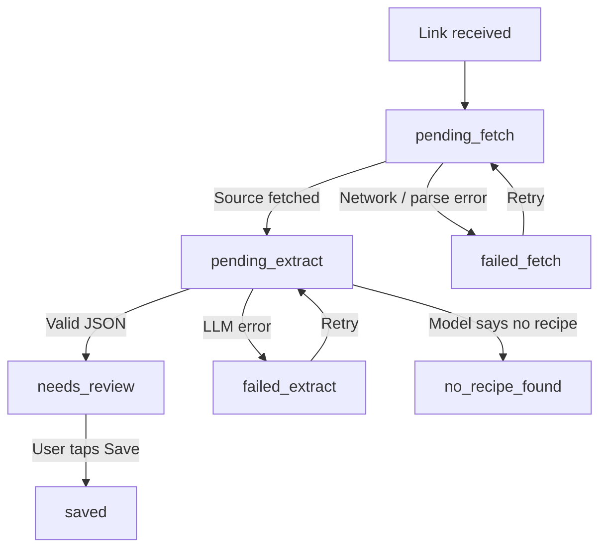
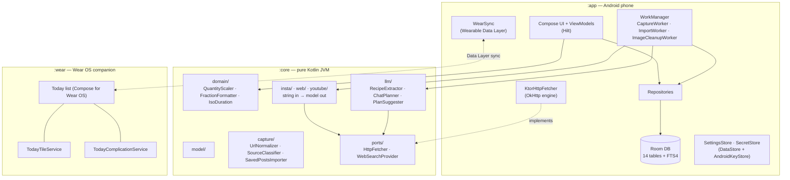
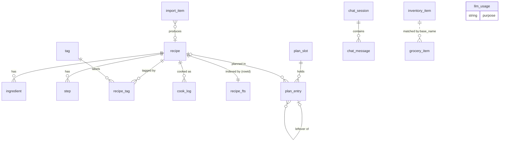
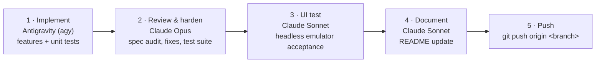

<div align="center">

# 🍲 Recipe Catcher

**Catch the recipe, not just the link.**

A personal, offline-first Android app that turns Instagram posts, recipe websites and YouTube videos into clean, structured, searchable recipe cards. No accounts, no backend and no tracking: everything stays on your phone.


</div>

---

## Contents

- [Why Recipe Catcher](#why-recipe-catcher)
- [Features](#features)
- [Architecture](#architecture)
- [Tech stack](#tech-stack)
- [Database schema](#database-schema)
- [Getting started](#getting-started)
- [Testing](#testing)
- [Build, signing and releases](#build-signing-and-releases)
- [Development workflow](#development-workflow)
- [Roadmap](#roadmap)
- [Documentation](#documentation)

---

## Why Recipe Catcher

Recipes on Instagram hide in long captions and "recipe in comments" replies. Saving the post keeps the link, not the recipe. Recipe websites have the opposite problem: the recipe sits under ads, pop-ups and a life story.

Recipe Catcher fixes both. Share a link from any app, and a few seconds later you have a structured card with ingredients, steps, servings, timings, equipment, diet flags and tags, ready to search, scale and cook from, even in airplane mode.

| Principle | What it means in practice |
| --- | --- |
| **Private by design** | Single user, single phone. No accounts, no server, no analytics, no telemetry. `android:allowBackup="false"` keeps data out of Google's cloud backup. |
| **Offline-first** | The library, search, viewer and cooking mode run entirely from the local database and image files. Only page fetches and LLM calls touch the network. |
| **You own the data** | Recipes live in a local SQLite database. The zip backup format is a documented data contract any future desktop or web client can read. |
| **Pennies, not subscriptions** | You bring your own Anthropic API key. Extraction costs about US$0.0006 per recipe (roughly US$0.06 per 100), and the in-app AI spend panel tracks every call. |
| **Nothing is ever lost** | Every capture writes a database row first and fills it in afterwards. Failed captures wait in a Pending section for retry, and the raw source text is always kept. |

---

## Features

Status key: ✅ available · 🚧 in progress · 🗓️ planned

### Multi-source capture

| Source | How it works | Status |
| --- | --- | --- |
| **Instagram** posts, reels and `/tv/` links | Three fetch strategies tried in order: official oEmbed → `/embed/captioned/` page → post-page meta tags. The thumbnail is downloaded immediately because Instagram CDN links expire. | ✅ |
| **Recipe websites** | schema.org `Recipe` JSON-LD first (walks arrays and `@graph`, normalises `HowToStep` / `HowToSection`, image and yield quirks), readable-text fallback capped at 12,000 characters, and a direct-mapping fallback so a JSON-LD recipe is never lost. `og:image` and `og:site_name` for cover and author. | ✅ |
| **YouTube** videos and Shorts | Parses `ytInitialPlayerResponse` for title, channel and full description, falls back to `og:` meta tags, and follows up to 2 linked recipe pages when the description itself has no recipe. | ✅ |
| **By hand** | Write recipe (empty form) and **Fill from pasted text** (a WhatsApp message, a family recipe) through the same extractor. | ✅ |

Capture runs in a WorkManager `CoroutineWorker` with a network constraint and exponential backoff, so it survives leaving the app. You can start it from the Android share sheet (a translucent `ShareReceiverActivity` over the source app) or the in-app **Paste link** screen. URLs are normalised and stripped of tracking parameters (`igsh`, `utm_*`, `fbclid`, `gclid`), and duplicates are caught by shortcode, video ID or normalised URL.



### AI extraction with Claude Haiku 5.5

- One Anthropic Messages API call per capture, using **structured outputs** with an all-required, non-nullable JSON schema, so responses are always schema-valid.
- Low effort, `max_tokens` 2,000, and `cache_control` on the system prompt so repeated captures pay the cache-read rate.
- Extracts title, servings, prep/cook/total time, cuisine, complexity (with a reason), spice level, diet type, "contains" flags, approximate kcal per serving, make-ahead and freezer flags, grouped ingredients with base names and categories, steps with timers, equipment, consumables and tags.
- Converts imperial and US units to metric, translates Hindi, Bengali or Hinglish captions to English, and picks tags only from your own lists.
- Post-call validation drops unknown tags, clamps servings to 1–50 and minutes to 0–1,440, and maps errors cleanly: 401/403 → "Check API key", 404 → "Model not found", 429/529/5xx → retry with backoff.
- The model ID is a setting, not a constant, so a model change needs no rebuild.
- **Re-extract** a saved recipe from its stored source text at any time without touching your personal notes, favourites or cook log.

### Fast offline search and filtering

- **SQLite FTS4** (`tokenize=unicode61`) over title, ingredients, steps, caption, author and personal notes, with prefix matching: `pan` finds *paneer*.
- **Filters combine with AND:** tags · diet type (vegan, vegetarian, eggetarian, non-veg) · "without" filters (no dairy, gluten-free, no onion & garlic…) · favourites · never cooked · complexity · equipment (e.g. air fryer) · spice level · make-ahead · freezer-friendly · to review.
- **Six sort orders:** newest saved, title A–Z, total time, calories, recently cooked and longest since cooked.
- 2-column card grid with a **Pending** section (count badge, retry) for captures that still need attention.

### Recipe viewer, scaling and fractions

- Cover image (Coil 3, local files only), meta row (time, complexity, spice, diet, ~kcal per serving, make-ahead / freezer badges) and a favourite star.
- **Servings stepper (1–50)** scales quantities live, including both ends of a range (2–3 cloves × 2 = 4–6), and leaves free text such as "to taste" alone.
- **Friendly formatting:** tsp, tbsp and pieces show fractions (½, ¼, ⅓, 1 ½); g and ml round to whole numbers (to the nearest 5 from 100 up); 1,000 g or ml and above switch to kg or l.
- Session-only ingredient checklist, ingredient group sub-headers, equipment and consumables, and **Open source** to jump back to the original post, page or video.

### Cooking mode

- Full-screen step pager with large, high-contrast text (24 sp and up).
- `FLAG_KEEP_SCREEN_ON` while cooking, so the screen never dims mid-step.
- **Per-step countdown timers** wherever the recipe states a duration, with a notification when time is up.
- **Ingredients bottom sheet** with the scaled list, available mid-cook.
- **Mark as cooked** at the end.

### Personal touches

These belong to you: the AI never writes them, and re-extraction never overwrites them.

- ⭐ **Favourites** on cards and in the viewer, with a filter chip.
- 📓 **Cook log** with dated entries, an optional one-line note ("less chilli next time") and an optional photo from the camera (via `FileProvider`, so no CAMERA permission is needed) or the system photo picker.
- 🖼️ **Cover photo:** promote any of your cook photos to the recipe cover while keeping the source image.
- 📝 **Personal notes** shown above the steps and included in search.
- 🏷️ **List manager** in Settings for tags, diet, equipment and consumables.
- 🧹 A weekly job removes orphaned image files left behind by cancelled or failed captures.

### Meal planner and Today screen ✅

- **Four bottom tabs** with **Today** as the default start screen.
- **Week plan** with daily slots for **cook**, **prep** and **leftover** entries.
- **`PortionLedger`** tracks portions cooked and eaten so leftovers are accounted for.
- **Add to plan** straight from the recipe viewer.

### Grocery and inventory lists ✅

- **`GroceryBuilder`** aggregates the week's plan into a shopping list and automatically subtracts what is already in your pantry inventory.
- Categorised checklist for shopping.
- Quick inventory status toggles to mark items as in stock or out.

### Reminders ✅

- `AlarmManager` alerts for **night-before prep** and **start-cooking** reminders.
- A **Done** action on the notification marks the reminder complete.
- `BootReceiver` reschedules pending alarms after a device restart.

### Home screen widget ✅

- Jetpack Glance **`TodayWidget`** shows today's planned meals on the home screen.
- Interactive action callbacks let you act on meals without opening the app.

### AI chat and web recipe search ✅

- **Claude chat** over your own library, with persisted message history and quick prompt chips such as **What can I cook tonight?** and **Use up my ingredients**.
- **Include web** toggle: when on, Claude also searches the web for recipes beyond your library.
- **Citation cards** link straight to a recipe in your Library or to a web source, with a one-tap **Save** that captures the web result into Recipe Catcher.
- If web search fails, the answer still arrives with a short note instead of an error.

### Find with AI ✅

On the Edit Recipe screen, **Find with AI** asks Claude to discover a recipe from a short query and autofills title, description, ingredients, steps, timings, cuisine and tags. A confirmation dialog appears before it overwrites anything you have already entered.

### AI plan suggestions ✅

**Fill empty slots with AI** on the Plan screen proposes varied meals for unscheduled slots from today onward, with awareness of leftovers already in the plan. A dialog opens with one pick per slot preselected, so you can adjust before adding them.

### Instagram saves bulk import ✅

Bring in your existing Instagram saves in one go:

- **Sources:** your Instagram data download (the **ZIP** or the extracted `saved_posts.json`) or a list of **pasted links**. `SavedPostsImporter` in `:core` parses them.
- **Collection names** from the export are preserved, so imported recipes keep the grouping you had on Instagram.
- **Rate-limited background processing** through `ImportWorker`: one link roughly every 30 seconds, with a **30-minute cooldown** after a failure so Instagram is never hammered.
- **Progress tracking** on the Import screen, backed by the `import_item` queue.
- **Skipped list with retry** for links that could not be fetched or had no recipe.

### Top comment fallback ✅

Many Instagram recipes live in the author's first comment ("recipe in comments"):

- When the caption has no recipe, a **foreground capture fallback** reads the author's comments with an **off-screen WebView** (`CommentFetcher`) and feeds them to the extractor.
- **Instagram login** in Settings lets the WebView see comments on posts that need a signed-in session. It is opt-in, and the session stays on your phone.

### Wear OS companion ✅

The `:wear` module puts today's meals on your wrist:

- **Today meal list** built with Compose for Wear OS.
- **Tile** (`TodayTileService`) with interactive meal ticks.
- **Complication** (`TodayComplicationService`) for watch faces.
- **Two-way sync** with the phone over the Google Play Services Wearable Data Layer. Ticks made on the watch reach `:app`, and plan changes on the phone reach the watch.

### Privacy and security

- The Anthropic API key is encrypted with an **AES-GCM key held in AndroidKeyStore**, with only the ciphertext stored in DataStore (`EncryptedSharedPreferences` is deprecated).
- No proprietary backend, no analytics SDKs, no telemetry. Network traffic is limited to fetching the page you shared and calling the Claude API with your own key.
- **Instagram login** (optional, for top comments) is stored on-device only.
- **Chat settings** in Settings hold the Anthropic API key, a default for **Include web**, and the maximum web searches per message.
- An **AI spend panel** in Settings shows running cost this month and all time, computed from every call's `usage` block logged to the `llm_usage` table.

### Backup and restore ✅

The safety net that makes the app your primary copy:

- `VACUUM INTO` for a consistent single-file database snapshot without closing Room.
- `manifest.json` with format version, schema version, counts and a **SHA-256** of the database.
- A zip of the manifest, database and all images, written through the **Storage Access Framework** to a remembered folder (for example a Syncthing folder).
- Restore with zip-slip protection, manifest and `PRAGMA integrity_check` validation, an automatic safety backup, and a clean process restart.
- An automatic backup before any database migration.

---

## Architecture

Recipe Catcher follows Clean Architecture across decoupled Gradle modules. Everything that does not need Android lives in a plain Kotlin module, so it is fast to test and portable to a future desktop or web client.



### `:core` — pure Kotlin JVM

A `kotlin("jvm")` module with **zero `android.*` / `androidx.*` imports or dependencies**.

| Package | Contents |
| --- | --- |
| `model/` | Immutable domain models: `Recipe`, `Ingredient`, `Step`, `Tag`, `CookLogEntry`, `PlanSlot`, `PlanEntry`, `InventoryItem`, `GroceryItem`, `ChatMessage`, `SourceType` |
| `domain/` | `QuantityScaler` (single values and ranges), `FractionFormatter`, `IsoDuration` |
| `capture/` | `UrlNormalizer`, `SourceClassifier` (Instagram, YouTube, web; tracking-parameter stripping), `SavedPostsImporter` (Instagram data download and pasted links) |
| `insta/` | `PostFetchStrategy` implementations: oEmbed, embed page, post-page meta |
| `web/` | `WebRecipeFetcher`, `JsonLdParser`, `ReadableTextExtractor` |
| `youtube/` | `YouTubeFetcher` (player-response and meta-tag parsing, linked-recipe discovery) |
| `llm/` | `RecipeExtractor` interface, `ClaudeExtractor`, `ChatPlanner`, `PlanSuggester`, prompts and JSON schema |
| `ports/` | Outbound interfaces (`HttpFetcher`, `WebSearchProvider`) that `:app` implements |

Planner (`PortionLedger`, `GroceryBuilder`, `ReminderPlanner`) and backup-format packages join `:core` as their features land.

**Rules**

- Parsers take strings and return models. There is no networking inside parsers, so every one is tested against saved HTML/JSON fixtures.
- `:core` reaches the outside world only through `ports/`.
- `RecipeExtractor` hides the provider: `ClaudeExtractor` is the only implementation today, and another can be added without touching callers.

### `:app` — Android phone

| Area | Implementation |
| --- | --- |
| UI | Jetpack Compose + Material 3, Navigation Compose. **Material You dynamic colour**, dark theme by default (Dark / Light / Follow system). |
| DI | Hilt (`@AndroidEntryPoint`, `@HiltViewModel`, Hilt-injected workers) |
| Persistence | Room + KSP, schema v1 with all 14 tables plus `recipe_fts`, `exportSchema = true` (schemas in `app/schemas/`) |
| Background | WorkManager `CoroutineWorker`s for capture, bulk import (`ImportWorker`) and image cleanup |
| Settings & secrets | DataStore Preferences; AES-GCM in AndroidKeyStore for the API key |
| Networking | Ktor client with the OkHttp engine, injected into `:core` as `HttpFetcher` |
| Images | Coil 3 from local files; `FileProvider` for camera captures |
| Watch sync | `WearSync` publishes plan data to the watch and applies its ticks (Google Play Services Wearable Data Layer) |

```text
app/src/main/java/org/eu/angsumanray/recipecatcher/
├── MainActivity.kt · ShareReceiverActivity.kt · RecipeCatcherApp.kt
├── capture/      CaptureWorker, ImageCleanupWorker
├── data/
│   ├── db/       RecipeDatabase, entities, DAOs, converters, starter lists
│   ├── image/    ImageStorageManager
│   ├── network/  KtorHttpFetcher
│   ├── repo/     RecipeRepository, RecipeFilter, TagRepository, CookLogRepository
│   └── settings/ SettingsStore, SecretStore
├── di/           DatabaseModule, NetworkModule
└── ui/           library, paste, review, viewer, cook, edit, settings, theme
```

### `:wear` — Wear OS companion

Compose for Wear OS with a Today list, a tile (`TodayTileService`) and a complication (`TodayComplicationService`), kept in sync with `:app` over the **Google Play Services Wearable Data Layer** (`WearDataListenerService` on the watch, `WearSync` on the phone). It uses the same application ID and signing key as `:app`, and the phone stays the single source of truth.

```text
wear/src/main/java/org/eu/angsumanray/recipecatcher/wear/
├── WearDataListenerService.kt
├── data/           synced Today state
├── ui/             Today meal list
├── tile/           TodayTileService
└── complication/   TodayComplicationService
```

### Architectural invariants

```bash
./gradlew verifyCoreIsolation
```

This root-level task fails the build if any source file under `core/src/main` imports `android.*` or `androidx.*`, **or** if `:core`'s compile or runtime classpath resolves any `android`, `androidx`, `com.android` or `com.google.android` artifact. CI runs it on every push.

---

## Tech stack

| Concern | Choice |
| --- | --- |
| Language | Kotlin 2.1 (JVM toolchain 21) |
| Platform | `compileSdk` / `targetSdk` 37 (Android 17), `minSdk` 31 (Android 12) |
| Build | Gradle 8.14 with version catalog (`gradle/libs.versions.toml`), AGP 8.13, KSP |
| UI | Jetpack Compose, Material 3 (dynamic colour), Navigation Compose |
| DI | Hilt (+ `hilt-work`, `hilt-navigation-compose`) |
| Database | Room + SQLite FTS4 |
| Background work | WorkManager |
| Settings / secrets | DataStore Preferences · AndroidKeyStore AES-GCM |
| HTTP | Ktor client (OkHttp engine on Android) |
| JSON | kotlinx.serialization |
| HTML parsing | Jsoup |
| Images | Coil 3 |
| LLM | Claude Haiku 5.5 (`claude-haiku-5-5`) via the Anthropic Messages API |
| Tests | JUnit 4, kotlin-test, Turbine, Ktor MockEngine, Robolectric, Room in-memory, WorkManager testing |
| CI / CD | GitHub Actions (tests + isolation check on every push; signed APK on `v*` tags) |

---

## Database schema

All fourteen tables plus the FTS table are created in **schema version 1**, including those whose screens arrive later, so building out the feature set needs no migrations. Any future change ships as a Room auto-migration with an exported schema and a migration test.



| Group | Table | Purpose |
| --- | --- | --- |
| Recipes | `recipe` | Source, status, timings, complexity, spice, diet, kcal, flags, favourite, personal note, image paths |
| | `ingredient` | Quantity (+ max for ranges), unit, name, `base_name`, category, note, raw line |
| | `step` | Ordered step text with optional `timer_seconds` |
| | `tag` | One table for four vocabularies: `tag`, `diet`, `equipment`, `consumable` |
| | `recipe_tag` | Recipe ↔ tag link with `source` (`ai` or `user`) |
| | `recipe_fts` | FTS4 (`unicode61`) over title, ingredients, steps, caption, author, notes |
| Personal | `cook_log` | Dated cook entries with optional note and photo |
| Capture | `import_item` | Bulk-import queue (status, attempts, collection) |
| | `llm_usage` | Tokens, cache reads and web searches per call, for the AI spend panel |
| Planner | `plan_slot` | Per-date meal slots with optional time |
| | `plan_entry` | Cook / prep / leftover entries; `recipe_id` and `from_entry_id` use `ON DELETE SET NULL` |
| Lists | `inventory_item` | In stock / low / out by `base_name` |
| | `grocery_item` | Grocery lines from plan, inventory or manual entry |
| Chat | `chat_session`, `chat_message` | Chat history with stored suggestion cards |

Calendar dates are stored as ISO-8601 text (`YYYY-MM-DD`) and slot times as `HH:mm` through TypeConverters, so day grouping can't drift with time zones; timestamps are epoch milliseconds.

---

## Getting started

### Prerequisites

- **Android Studio**, a recent stable release that supports AGP 8.13
- **JDK 21** (the Gradle toolchain and CI both use Temurin 21)
- **Android SDK Platform 37** (Android 17) and current build tools
- An **Anthropic API key** for capture and extraction
- An Android 12+ phone, or the `Medium_Phone_API_37.0` emulator

### Build and install

```bash
git clone <repo-url> recipe-catcher
cd recipe-catcher

# Debug APK (application ID suffix .debug, so it installs alongside a release build)
./gradlew :app:assembleDebug

# Install on a connected device or emulator
./gradlew :app:installDebug
# or
adb install -r app/build/outputs/apk/debug/app-debug.apk
```

### First run

1. Open **Settings → API key**, paste your Anthropic key, and tap **Test**.
2. Leave **Model ID** as `claude-haiku-5-5` unless you want to try another model.
3. Share an Instagram post to **Recipe Catcher** from the share sheet, or tap **Add → Paste link**.
4. Review the extracted recipe, adjust tags, and tap **Save**.

---

## Testing

```bash
# Architectural guard: :core must stay free of Android
./gradlew verifyCoreIsolation

# All JVM unit tests (:core and :app, including Robolectric)
./gradlew test
```

Both must pass cleanly before any feature is considered done.

| Layer | Coverage |
| --- | --- |
| `:core` | `UrlNormalizer`, `SourceClassifier`, `QuantityScaler`, `FractionFormatter`, `IsoDuration`, domain models; Instagram, web (JSON-LD, quirks, `@graph`, article fallback) and YouTube parsers against fixtures in `core/src/test/resources/`; `ClaudeExtractor` against Ktor `MockEngine` (request shape, success, 401, 404, 429, no recipe, truncated or refused responses, post-call validation) |
| `:app` | Room database and FTS in memory, library filters and cooking flows, `CaptureWorker` state transitions, `SettingsStore`, viewer and cooking-mode ViewModels |

### Headless emulator UI testing

On-device acceptance testing uses the `android-testing` agent skill's `droid.sh` driver (in `~/.agents/skills/android-testing/scripts/`) against the `Medium_Phone_API_37.0` AVD:

```bash
DROID=~/.agents/skills/android-testing/scripts/droid.sh

$DROID emu-start Medium_Phone_API_37.0          # boot headless, prints the serial
$DROID install app/build/outputs/apk/debug/app-debug.apk
$DROID launch org.eu.angsumanray.recipecatcher.debug
$DROID ui                                        # on-screen text with tap targets
$DROID shot /tmp/library.png                     # screenshot for verification
$DROID crash org.eu.angsumanray.recipecatcher.debug
$DROID emu-stop
```

> [!IMPORTANT]
> Screenshots are for verification reports only and are never committed (`screenshots/` and `docs/screenshots/` are git-ignored). On a physical device, never touch real user data: baseline with `droid.sh hash` and confirm checksums are unchanged afterwards.

---

## Build, signing and releases

- **CI on every push and pull request:** `verifyCoreIsolation` and `test` on JDK 21 (`.github/workflows/ci.yml`).
- **Releases:** pushing a tag such as `v1.2.3` builds `:app:assembleRelease` with R8, signs it, fails if the APK is unsigned, and attaches it to a GitHub Release. `versionName` comes from the tag and `versionCode` from the workflow run number.
- **Signing key:** generated once with `scripts/generate-keystore.sh`, stored base64-encoded as Actions secrets (`KEYSTORE_BASE64`, `KEYSTORE_PASSWORD`, `KEY_ALIAS`, `KEY_PASSWORD`) and kept offline in a password manager. Android only installs updates signed with the same key, so every release installs over the previous one with all data intact.
- **Local release builds** can point at a keystore with `KEYSTORE_PATH` plus the same password and alias variables.
- **Distribution:** sideloaded from the GitHub Release. There is no Play Store listing.

---

## Development workflow

Recipe Catcher is built in waves by a multi-agent pipeline. Each wave moves through a strict, sequential lifecycle before it is pushed upstream:



| Stage | Owner | Output |
| --- | --- | --- |
| Implementation | Antigravity (`agy`) | Features and unit tests |
| Code review & hardening | Claude Opus | Spec audit, defect fixes, green `verifyCoreIsolation` and `test` |
| UI testing | Claude Sonnet | Emulator acceptance run on `Medium_Phone_API_37.0` (screenshots never committed) |
| README update | Claude Sonnet | This document kept current with shipped capabilities |
| Upstream push | — | Branch pushed once committed, verified and clean |

**Conventions**

- Tasks are tracked in [`docs/Waves.md`](docs/Waves.md): completed items are ticked, superseded ones struck through, never deleted.
- Commit messages describe the capability or fix (`feat: add web and YouTube recipe fetchers`), with no wave or task numbers.
- Agent guidelines, module invariants and tooling live in [`AGENTS.md`](AGENTS.md).

---

## Roadmap

Every wave ends with a tagged, signed release that installs over the previous one.

| Wave | Theme | Highlights | Status |
| --- | --- | --- | --- |
| **0** | Foundation | Modules, version catalog, CI, signing, domain models, scaler, formatter, URL normaliser | ✅ Done |
| **1** | Instagram capture | Ktor fetcher, three Instagram strategies, `ClaudeExtractor`, Room schema v1, secure settings, `CaptureWorker`, share sheet and Paste link, Review & Save, AI spend panel | ✅ Done |
| **2** | Library, cooking, personal touches | FTS search, filters and sorts, viewer with scaling, cooking mode with timers, cook log with photos, favourites, notes, Write recipe, list manager, Re-extract, image cleanup | ✅ Done |
| **3** | Web, YouTube, backup | `WebRecipeFetcher`, `YouTubeFetcher`, clipboard detection, WebView retry for blocked sites, `BackupManager`, `RestoreManager`, pre-migration backup | ✅ Done |
| **4** | Planner, lists, widget | Bottom tabs with Today as home, week planner with cook / prep / leftover entries, grocery list and inventory, reminders, Glance `TodayWidget` | ✅ Done |
| **5** | Chat, Find with AI, Suggest | Recipe chat over your library with optional web search and citations, Find with AI on the edit form, `PlanSuggester` for empty plan slots | ✅ Done |
| **6** | Bulk import, Wear OS | Instagram saves bulk import with collections and rate-limited background processing, top-comment fallback, `:wear` app with Today list, tile and complication | ✅ Done |
| **7** | Media (later) | Recipes from images via Haiku 5.5 image input; voice and transcript extraction | 💭 Later |


---

## Documentation

| Document | What it covers |
| --- | --- |
| [PRD](docs/PRD.md) | Problem, goals, user stories, scope, success criteria and risks |
| [App spec](docs/App%20spec.md) | Screen-by-screen behaviour, capture flows, settings, chat, import and planning |
| [Tech spec](docs/Tech%20spec.md) | Stack, data model, fetchers, LLM calls, planner internals, backup format, build and testing |
| [Waves](docs/Waves.md) | Build order and live task tracker |
| [AGENTS.md](AGENTS.md) | Agent guidelines, module invariants and the multi-agent lifecycle |

---

<div align="center">

Built for one kitchen, one phone and a lot of saved reels. 🍳

</div>
