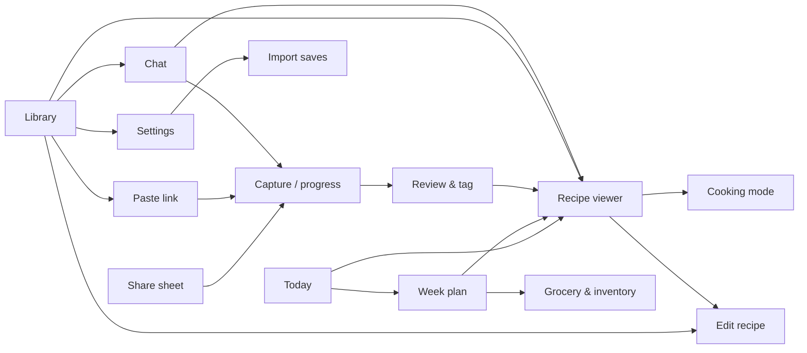
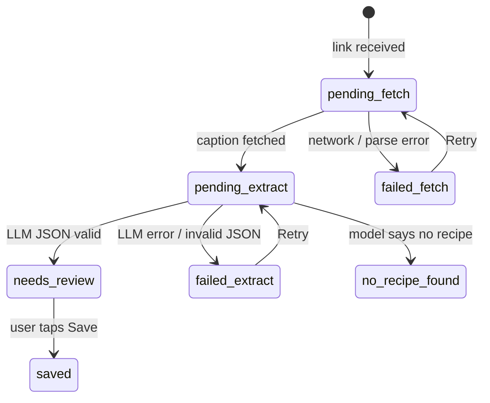

# Recipe Catcher — App Spec

What the app does, screen by screen: navigation, capture flows, library and cooking, settings, chat, import and planning. Goals and scope live in the PRD tab, implementation detail in the Tech spec tab, and build order in the Waves tab. References to other tabs name the tab, e.g. "Tech spec section 3".

## 1. Screens and navigation

The app has thirteen screens in one activity, plus a translucent share-receiver activity that shows the capture flow over Instagram.

Bottom tabs: Today (the start screen), Plan, Library and Lists; chat and Settings sit in the top bar. Before the planner exists (Waves 1–3), the app opens straight on Library, with Settings and the add actions in its top bar; Wave 4 switches to the bottom tabs with Today as the default. Saving from the review screen opens the viewer, or closes back to the source app when capture started from the share sheet.

| Screen | Purpose | Key elements |
| --- | --- | --- |
| Today (P1) | Home: what's due today | To cook, To prep, Leftovers to eat, Tonight's prep for tomorrow; tick to mark done; tap to open the recipe or cooking mode |
| Week plan (P1) | Plan any week | Day columns or list, editable slots per day, entries (cook / prep / leftover), Suggest, Copy last week's layout, week switcher |
| Lists (P1) | Shop and track stock | Two tabs: Grocery (build from plan, categories, tick to buy) and Inventory (in stock / low / out) |
| Library | Browse and find recipes | Search bar, filter chips (tags, diet, "without" filters, favourites, complexity, equipment, spice, make-ahead, freezer), 2-column card grid (cover, title, time, complexity), "Pending" section, add button (Paste link / Write recipe), chat button in the top bar |
| Paste link | Manual capture | URL field auto-filled from clipboard if it holds an Instagram, YouTube or web link, Capture button |
| Capture / progress | Show fetch and extraction state | Steps: Fetching → Reading recipe → Done; Cancel; error card with Retry / Save as pending |
| Review & tag | Confirm before saving | Editable title, servings, times, complexity, spice level, diet type, "contains" flags, calories, make-ahead and freezer flags; ingredient and step lists; equipment and consumables; tag chips (AI picks pre-selected); collapsible raw source text; Save |
| Recipe viewer | Read and cook | Cover image, title, meta row (time, complexity, spice, diet, \~kcal per serving, make-ahead / freezer badges), favourite star, servings stepper, ingredient checklist, equipment and consumables, numbered steps, tags, personal notes, "Mark as cooked" and cook history with photos, "Add to plan", "Open source", Cook button |
| Cooking mode | Hands-busy cooking | Full-screen step pager, large text, keep-screen-on, swipe or tap to advance, ingredients bottom sheet, "Mark as cooked" at the end |
| Edit recipe | Fix anything, or write a recipe from scratch | Same form as review, plus personal notes, "Find with AI" and "Fill from pasted text"; Re-extract from source text (P1); Delete |
| Chat (P1) | "What should I cook?" | Message list, quick-prompt chips, "Include web" toggle, recipe cards in replies, chat history |
| Import saves (P1) | Bring in a backlog | Pick export file or paste links, "N new, M already saved" preview, collection-tags switch, progress, Pause / Resume, Skipped list |
| Settings | Configure and back up | Theme, week start and reminders, API key, model ID, list manager (tags, diet, equipment, consumables), Instagram login for comments, chat defaults, AI spend, Import saves, Backup now, Restore, About |

**Look and feel:** Material 3 with dynamic colour taken from the wallpaper (Material You), available on every supported phone since the minimum is Android 12. The app starts in dark theme; Settings → Theme switches between Dark, Light and Follow system. A fixed fallback colour scheme is used only for Compose previews and screenshot tests.

## 2. Capture flow

Every capture writes a row first and fills it in afterwards, so nothing shared is ever lost. Instagram and website links share the same states; the website differences are listed at the end of this section.

Failed, no-recipe and needs-review rows appear in the library's Pending section until resolved.

1. **Receive.** Accept `ACTION_SEND` with `text/plain`. Extract the first URL matching `instagram.com/(p|reel|reels|tv)/<shortcode>`. Strip tracking params (`igsh`, `utm_*`).
2. **Dedupe.** If the shortcode already exists, open that recipe and show a "Already saved" snackbar. No new row.
3. **Insert row** with status `pending_fetch`, the canonical URL and the shortcode.
4. **Fetch post.** Caption, author handle, thumbnail URL (strategies in Tech spec section 3). Download the thumbnail to app storage immediately.
5. **Fetch top comment** only if the Instagram login is enabled in Settings *and* the caption fails a quick recipe heuristic (fewer than 3 lines that look like quantities).
6. **Extract.** Send caption (+ comment) and the tag list to the LLM; receive JSON (Tech spec section 4).
7. **Review.** Show the review screen pre-filled. A background job can't open a screen, so the capture screen watches the row and switches to review when it reaches needs\_review; if you've left, the row waits in Pending. Save sets status `saved`. Back leaves it as `needs_review` in Pending.
8. **Background safety.** Steps 4–6 run in a WorkManager job with network constraint, so they survive leaving the app and retry with backoff.

**Escape hatches:** on `failed_fetch`, offer "Paste caption manually"; on `no_recipe_found`, offer "Enter recipe by hand".

**Website links**

- Step 1 treats any other `http(s)` URL as `web`. Normalize it by following redirects, lowercasing the host, and dropping `utm_*`, `fbclid`, `gclid` and the fragment.
- Step 2 dedupes on the normalized URL instead of a shortcode.
- Step 4 runs the website fetcher (Tech spec section 3); step 5 never runs.
- `failed_fetch` offers "Paste page text" instead of "Paste caption".

**YouTube links**

- Step 1 recognises `youtube.com/watch?v=`, `youtu.be/`, `youtube.com/shorts/` and `m.youtube.com` links; the video ID is the dedupe key.
- Step 4 runs the YouTube fetcher (Tech spec section 3): title, channel, full description and thumbnail.
- If the description has no recipe but links to a recipe page, the app runs that link through the website importer, keeping the video as the source link.
- If there is still no recipe, the row becomes `no_recipe_found`; Wave 7 adds transcripts for these.

**Recipes added by hand**

- Library → add → Write recipe opens the edit form empty, with `source_type = manual` and no source link.
- **Find with AI:** type a dish name and any hints ("Bengali style, no onion"). The app runs a web search and shows up to 3 candidate recipes (title, site, why it fits); picking one runs it through the website importer and fills the form. The recipe then counts as a web recipe with its page as the source.
- **Fill from pasted text:** text you paste (a WhatsApp message, a family recipe, a cookbook page you typed out) goes through the normal extractor to fill the form.
- Either way, nothing is saved until you finish editing and tap Save. Chat web cards work the same: Save opens the filled review form first.
- Typed recipes skip the fetch steps, and dedupe doesn't apply to them.

## 3. Library, viewer, cooking mode

All three work fully offline from the local database and image files.

**Library**

- Default sort: newest saved first. Other sorts: title A–Z, total time, calories, recently cooked, longest since cooked.
- Search matches title, ingredients, steps, caption, author and personal notes, via FTS with prefix matching (`pan*` finds "paneer").
- Filter chips: tags, diet type (vegan, vegetarian, eggetarian, non-veg), "without" filters from the contains list (no dairy, gluten-free, no onion & garlic…), favourites, never cooked, complexity, equipment (e.g. "air fryer"), spice level, make-ahead, freezer-friendly, and "To review" for bulk-imported recipes. Filters combine with AND; selected chips stay pinned at the start of the row.
- Pending section is hidden when there are no pending rows, and shows a count badge otherwise.
- Long-press a card: Favourite, Edit, Share link, Delete.

**Recipe viewer**

- Servings stepper scales quantities live. Scaling multiplies parsed numeric quantities only, both ends of a range included (2–3 cloves × 2 = 4–6); free text ("to taste", "a pinch") stays unchanged.
- Display rules after scaling: tsp, tbsp and pieces show fractions (0.5 → ½, 0.25 → ¼, 0.333 → ⅓); g and ml show whole numbers, rounded to the nearest 5 at 100 or more; values reaching 1,000 g or ml switch to kg or l with one decimal.
- Ingredient checkboxes are session-only (not persisted); a "Clear" action resets them.
- Ingredient groups ("For the gravy") render as sub-headers when the LLM returns them.
- "Open post" launches the Instagram app with the canonical URL, falling back to the browser.

**Cooking mode**

- One step per page, text at least 24 sp, high contrast.
- `FLAG_KEEP_SCREEN_ON` while the screen is visible.
- Timer chip on any step where the LLM extracted a duration; tap starts an in-app countdown with a notification.
- Ingredients bottom sheet shows the scaled list with the same checkboxes as the viewer.

**Personal touches**

These belong to you: the AI never writes them, and re-extracting a recipe never overwrites them.

- **Favourite:** a star on the viewer and on library cards, with a filter chip.
- **Cooked log:** "Mark as cooked" on the viewer and at the end of cooking mode adds a dated entry with an optional one-line note ("less chilli next time") and an optional photo of your attempt, from the camera or gallery. The viewer shows how many times and when last, with the photos; the library can sort by it.
- **Cover photo:** any of your cook photos can be set as the recipe's cover instead of the source image; the source image is kept.
- **Personal notes:** free text shown above the steps and included in search.

The AI fills these in during extraction, and you can edit them on the review and edit screens (rules in Tech spec section 4):

- **Equipment:** appliances and cookware the recipe needs, from your equipment list (air fryer, OTG, pressure cooker, kadai…).
- **Consumables:** single-use items, from your consumables list (parchment paper, foil, cling film…).
- **Complexity:** easy, medium or hard, with a one-line reason; your override wins.
- **Spice level:** mild, medium or hot.
- **Make-ahead** and **freezer-friendly:** two yes / no flags, set only when the recipe says so or clearly allows it.
- **Diet type:** vegan, vegetarian, eggetarian or non-veg.
- **Contains:** flags from your diet list (dairy, gluten, egg, nuts, onion & garlic…), which power the "without" filters. These are AI estimates: for an allergy, always check the ingredients.
- **Calories:** an approximate kcal per serving, estimated from the ingredients and shown as "\~450 kcal per serving (estimate)"; blank when the quantities are too vague.

## 4. Settings, backup and restore

Settings holds five groups: AI, Chat, Tags, Instagram, Backup.

| Setting | Type | Default | Notes |
| --- | --- | --- | --- |
| Theme | Choice | Dark | Dark, Light or Follow system; colours always come from the wallpaper |
| Week starts on | Day | Monday | First day shown in the planner |
| Night-before prep alert | Time + toggle | 9:00 pm, on | For Prep entries marked "prep the night before" |
| Start-cooking alerts | Toggle | on | For Cook entries in slots with a time |
| API key | Secret text | empty | Anthropic API key; stored encrypted; AI features are blocked with a prompt until set |
| Model ID | Text | `claude-haiku-5-5` | Free text so a model change needs no rebuild; "Test" button sends a tiny request |
| Chat model ID | Text | same as Model ID | Lets the chat use a stronger model later without changing extraction |
| Include web by default | Toggle | off | Default for the chat's "Include web" chip |
| Max web searches per message | Number | 3 | Caps search charges for chat and Find with AI; passed as the web search tool's `max_uses` |
| AI spend | Read-only panel | — | Running cost this month and all time, split into extraction, chat, planning and web search, with a "Reset" action |
| Model prices | Number fields | Haiku 5.5: US$0.10 in, US$0.50 out, US$0.01 cache read per million tokens; US$0.01 per search | Used for the AI spend panel; editable when prices or models change |
| Lists | List editor | starter lists | Tags, diet ("contains"), equipment, consumables: add, rename, delete, merge; rename/merge rewrites existing recipes |
| Allow new AI tags | Toggle | off | Off = AI may only pick from the lists |
| Instagram login | Button + status | logged out | Opens an in-app WebView to instagram.com; logout clears its cookies |
| Fetch top comment | Toggle | off | Enabled only when logged in |
| Backup now | Action | — | System "Create document" picker, suggested name `recipes-YYYYMMDD-HHmm.zip` |
| Remember backup folder | Toggle | on | Persist the folder URI so later backups are one tap |
| Backup reminder | Number | 10 | Snackbar after N new recipes since last backup; 0 = off |
| Restore | Action | — | System "Open document" picker for a `.zip` |

**Backup behaviour**

- Runs in the foreground with a progress dialog; typical size is a few MB per 100 recipes.
- On success, show the file name and time and store `last_backup_at`.
- The API key and Instagram cookies are never included.

**Restore behaviour**

- Validate the zip first (manifest, schema version, database integrity). Invalid → error, nothing touched.
- Confirm dialog: "Replace all N recipes with M recipes from backup?" Restore is replace-all in v1; merge is out of scope.
- Before replacing, write an automatic safety backup to app-private storage, kept until the next successful restore.
- Restart the app process after restore so Room reopens cleanly.

## 5. Recipe chat (P1)

The chat answers "what should I cook?" from your saved recipes first, and from the web only when you turn that on.

**Screen**

- Opened from the chat button in the library's top bar; starts a new chat or resumes the last one from today.
- Quick-prompt chips above the input: "Something quick", "Comfort food", "Use what I have", "Light dinner".
- An "Include web" toggle chip next to the input, defaulting to the Settings value; it applies per message.
- Ingredients on hand are typed in the message. A saved pantry list is out of scope for v1.
- A "New chat" action, and a history list of past chats (title, date) with swipe to delete.

**Replies**

- Each assistant reply is short text plus a horizontal row of up to 5 recipe cards.
- Library cards show thumbnail, title, total time, the reason it fits, and "Missing: x, y" when you lack ingredients. Tap opens the viewer.
- Web cards show title, site, the reason it fits, and two buttons: Open (browser) and Save (runs the website import from section 2, ending on the review screen).
- Web cards only show pages the search actually returned, never URLs the model made up.
- If the request is too vague, the reply asks one follow-up question instead of guessing.
- No network: the chat shows an offline banner; library browsing still works as normal.

**Data:** chats and their messages live in the database, so they are included in backups automatically.

## 6. Import Instagram saves (P1)

This brings your backlog of saved Instagram posts into the library in the background, using Instagram's own data download.

**Getting the file:** in Instagram, go to Accounts Center → Your information and permissions → Download your information, and choose JSON format ([Instagram help](https://help.instagram.com/ipad-app/181231772500920)). The download includes a `saved_posts.json` file of your saves ([example tool using it](https://pypi.org/project/ig2raindrop-cli/)).

**Flow**

1. Settings → Import saves → pick the export zip or `saved_posts.json`, or paste a block of text containing links.
2. The app pulls out every Instagram post and reel link, drops ones already in the library, and shows "N new posts found, M already saved". A switch offers "Tag with collection names" when the export has collections.
3. Start: links join a background queue that takes one post about every 30 seconds, through the normal capture flow (section 2).
4. Imported recipes are saved straight into the library marked "To review", so you can check them in batches instead of one by one; opening one in Edit and saving clears the mark.
5. A progress screen shows done, remaining and skipped counts, an estimated finish time, and Pause / Resume. The queue survives app restarts and reboots.
6. After 3 fetch failures in a row the queue pauses itself for 30 minutes, in case Instagram is rate-limiting.
7. Posts with no readable recipe go to a Skipped list. They stay retryable, for example once Wave 7 can read images and audio.

LLM cost is about US$0.30 per 500 posts. At one post every 30 seconds, 300 posts take about 2.5 hours.

## 7. Week plan, Today, grocery list and inventory (P1)

You plan the week yourself and the AI suggests only when asked; Today, the widget, reminders, the grocery list and the inventory all run locally with no LLM calls.

**Week plan**

- A week starts on the day set in Settings (default Monday). Each day has its own slots, which you add, rename, reorder or delete at any time, so every week can look different. A slot can have an optional time ("Lunch, 1:30 pm"). "Copy last week's layout" copies the slots, not the food.
- A slot holds one or more entries of three kinds:
  - **Cook:** a recipe and how many portions you're making (defaults to the recipe's servings), plus how many are eaten at that meal (default 1).
  - **Prep:** something quick, either a recipe or free text ("cereal", "overnight oats"), optionally marked "prep the night before".
  - **Leftover:** portions from an earlier Cook entry. Picking one shows what's left ("Dal, 2 of 4 portions left").
- Change anything on the fly: swap a recipe because an ingredient ran out, move an entry to another day (long-press → Move), or clear a slot. "Add to plan" on the recipe viewer drops a recipe into a chosen slot.
- **Suggest**, on one slot or "Fill empty slots", makes one AI call that proposes recipes from your library; you accept or dismiss each. This is the only LLM use in planning.

**Today (home screen and widget)**

- Sections: To cook, To prep, Leftovers to eat, and Tonight's prep for tomorrow, each item with its slot and time.
- Ticking a Cook entry also adds it to that recipe's cooked log (photo optional) and makes its leftover portions available.
- Tapping an item opens the recipe, or cooking mode for a Cook entry. With nothing planned, Today shows a shortcut to the Plan tab.
- The home-screen widget shows the same list with tick boxes, and refreshes whenever something changes and just after midnight.

**Reminders** (individual alerts, no daily summary)

- Night-before prep: at the time set in Settings (default 9 pm), for Prep entries marked "prep the night before".
- Start cooking: for Cook entries in a slot with a time, at the slot time minus the recipe's total time (30 minutes when unknown).
- Each alert has a "Done" action, and each kind can be switched off in Settings.

**Grocery list** (Lists tab)

- "Build from plan" for the current or next week merges the ingredients of the week's Cook and Prep recipe entries, scaled to the planned portions. Leftover entries add nothing.
- Same ingredients combine when their units can (200 g + 300 g paneer = 500 g); otherwise they share one line ("tomatoes: 3 pc + 200 g").
- Grouped by category: vegetables, fruit, dairy, meat & fish, grains & flours, spices, pantry, other.
- Inventory items that are in stock are left out; low ones stay in, marked "running low"; items marked out are added even if no recipe needs them.
- You can add your own items, and rebuilding keeps them and your ticks. Ticking an item marks it bought and sets it in stock in the inventory.

**Inventory** (Lists tab)

- What you keep at home, each item in stock, low or out, grouped by the same categories.
- Setting an item to out puts it on the grocery list; low shows there as optional.
- Add items by hand, or from a recipe's ingredient list ("I have these").
- Recipe ingredients match inventory items by base name ("red onion, finely chopped" matches "onion"). The extractor provides the base name during capture, so matching needs no extra AI calls.

**Watch (Wear OS)**

- **Tile:** today's remaining items (up to 4) with tick buttons, plus a count of the rest.
- **Complication:** for the watch face, the number left today or the next item ("Prep oats, 9 pm").
- **Small watch app:** the full Today list with tick-off, opening on tap from the tile or complication.
- **Alerts:** the phone's alerts already appear on the watch with their "Done" action, so the watch adds no alerts of its own and you never get duplicates.
- The phone stays the single source of truth. A tick on the watch updates the phone, which updates the widget and the tile; ticks made while the watch is out of range apply when it reconnects.
