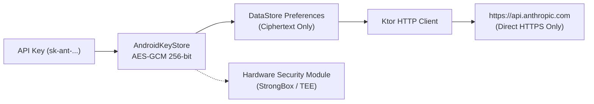
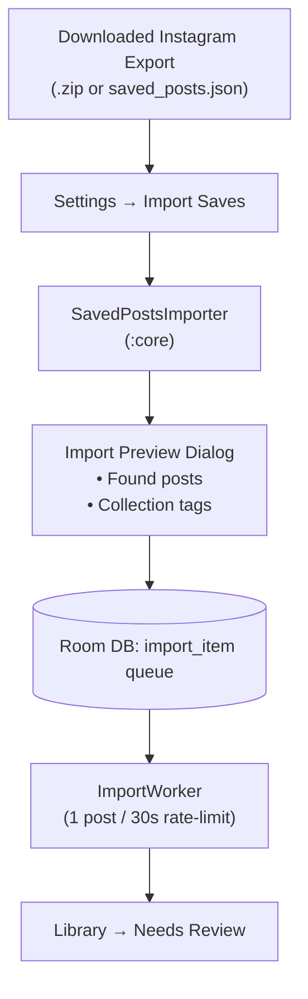

# Recipe Catcher — Setup & Installation Guide

This guide provides complete, step-by-step instructions for installing and configuring **Recipe Catcher** on your Android phone and Wear OS companion watch, setting up your Anthropic API key, and performing a bulk import of your saved Instagram recipes.

---

## Table of Contents

1. [Prerequisites & Overview](#1-prerequisites--overview)
2. [Installation Guide](#2-installation-guide)
   - [Phone App (`app-release.apk`)](#phone-app-app-releaseapk)
   - [Wear OS Companion App (`wear-release.apk`)](#wear-os-companion-app-wear-releaseapk)
3. [Anthropic API Key Setup](#3-anthropic-api-key-setup)
   - [Creating an Anthropic Account & API Key](#creating-an-anthropic-account--api-key)
   - [Entering the Key in Recipe Catcher](#entering-the-key-in-recipe-catcher)
   - [Security & Hardware-Backed Key Storage](#security--hardware-backed-key-storage)
4. [Instagram Data Export & Bulk Sync](#4-instagram-data-export--bulk-sync)
   - [Downloading Data from Meta Accounts Center](#downloading-data-from-meta-accounts-center)
   - [Importing into Recipe Catcher](#importing-into-recipe-catcher)
   - [Import Queue & Background Processing](#import-queue--background-processing)

---

## 1. Prerequisites & Overview

Recipe Catcher is an offline-first, private personal recipe manager. All recipes, photos, meal plans, and inventory stay strictly on your local device.

### System Requirements

| Device | Requirements | Notes |
| --- | --- | --- |
| **Android Phone** | Android 12+ (`minSdk 31`), API 31–37 | Optimized for Android 15 & 17 (API 37) with Material You dynamic color. |
| **Wear OS Watch** *(Optional)* | Wear OS 3.0+ (API 33+) | Pairs with phone via Google Play Services Wearable Data Layer. |
| **Anthropic Account** | Active Anthropic Console account | For Claude Haiku 5.5 extraction, vision scanning, and meal chat. |
| **Storage** | ~100 MB free internal storage | Recipe cards, cover photos, and local SQLite database. |

> [!NOTE]
> Network access is only required when fetching shared links or calling the Claude API for recipe extraction. Browsing, offline search, ingredient scaling, cooking mode, meal planning, and Wear OS sync work 100% offline.

---

## 2. Installation Guide

Recipe Catcher is distributed as direct release APKs via [GitHub Releases](https://github.com/inthevortex/recipe-catcher/releases). There is no Google Play Store listing.

### Phone App (`app-release.apk`)

#### Option A: Direct Sideloading on Device (Recommended)

1. On your phone, open your browser and navigate to the latest release on [GitHub Releases](https://github.com/inthevortex/recipe-catcher/releases).
2. Download `app-release.apk`.
3. Tap the download notification or locate the APK in your **Files** / **Downloads** app.
4. If prompted with *"For your security, your phone is not allowed to install unknown apps from this source"*:
   - Tap **Settings** on the prompt.
   - Toggle **Allow from this source** to **On**.
   - Tap the back button and tap **Install**.
5. Once installation finishes, open **Recipe Catcher**.

#### Option B: Installation via ADB (Android Debug Bridge)

If you have a computer with `adb` installed:

1. Enable Developer Options on your phone:
   - Go to **Settings → About phone**.
   - Tap **Build number** 7 times until you see *"You are now a developer!"*.
   - Go to **Settings → System → Developer options** and enable **USB debugging**.
2. Connect your phone to your computer with a USB cable (authorise the computer when prompted on your phone).
3. Download `app-release.apk` to your computer.
4. Open a terminal and run:
   ```bash
   adb install -r app-release.apk
   ```
5. Confirm installation by launching the app:
   ```bash
   adb shell am start -n org.eu.angsumanray.recipecatcher/org.eu.angsumanray.recipecatcher.MainActivity
   ```

---

### Wear OS Companion App (`wear-release.apk`)

The Wear OS app puts today's scheduled meals and interactive checkboxes on your wrist with a dedicated Tile and Complication.

> [!IMPORTANT]
> Both the phone and watch apps must be signed with the same release key for Google Play Services Wearable Data Layer to communicate. Always install the corresponding `wear-release.apk` matching your phone's `app-release.apk` version.

#### Option A: Wireless Debugging via ADB (Computer)

1. Connect your Wear OS watch and your computer to the **same Wi-Fi network**.
2. Enable Developer Options on your watch:
   - Open **Settings → System → About → Versions**.
   - Tap **Build number** repeatedly until developer mode is enabled.
3. Open **Settings → Developer options**:
   - Enable **Wireless debugging**.
   - Wait a moment for the watch to connect to Wi-Fi.
   - Tap **Pair new device**. Note the **Wi-Fi pairing code** and **IP address & Port** (e.g. `192.168.1.150:42123`).
4. On your computer, open a terminal and pair with the watch:
   ```bash
   adb pair <watch_ip>:<pairing_port> <pairing_code>
   # Example: adb pair 192.168.1.150:42123 123456
   ```
5. Return to the main **Wireless debugging** screen on the watch and note the primary connection port under **IP address & Port** (e.g. `192.168.1.150:38995`).
6. Connect ADB to the watch:
   ```bash
   adb connect <watch_ip>:<connection_port>
   # Example: adb connect 192.168.1.150:38995
   ```
7. Install the watch APK:
   ```bash
   adb -s <watch_ip>:<connection_port> install -r wear-release.apk
   ```
8. Turn off **Wireless debugging** on the watch when finished to preserve battery.

#### Option B: Phone-to-Watch Sideloading (No Computer Needed)

You can sideload `wear-release.apk` directly from your Android phone to your watch using dedicated mobile tools:

- **GeminiMan Wear OS Manager**:
  1. Install [GeminiMan Wear OS Manager](https://play.google.com/store/apps/details?id=com.geminiman.wearosmanager) from Google Play on both your phone and watch.
  2. Follow the in-app pairing instructions using Wireless Debugging.
  3. Select **Install APK File on Watch**, choose `wear-release.apk` downloaded on your phone, and install.
- **Bugjaeger Mobile ADB**:
  1. Install [Bugjaeger](https://play.google.com/store/apps/details?id=eu.sisik.hackendebug) on your phone.
  2. Enable Wireless Debugging on the watch, pair, and connect in Bugjaeger's devices tab.
  3. Go to the **Packages** tab (`+` icon), select `wear-release.apk`, and tap install.

---

## 3. Anthropic API Key Setup

Recipe Catcher uses **Claude Haiku 5.5** for fast, structured recipe extraction and vision scanning, and optionally **Claude Sonnet 5.5** for conversational meal planning. You bring your own API key, paying only for what you consume (fractions of a cent per recipe).

### Creating an Anthropic Account & API Key

1. Go to the [Anthropic Console](https://console.anthropic.com/).
2. Sign in or create a new account.
3. Add billing credits:
   - Navigate to **Plans & Billing**.
   - Add an initial credit (e.g. $5). Because Claude Haiku 5.5 extractions cost approximately **$0.0006 per recipe** (~$0.06 per 100 captures), $5 is enough for thousands of recipes.
4. Generate an API Key:
   - Click your profile icon or go to **API Keys** in the navigation menu.
   - Click **Create Key**.
   - Give the key a name (e.g. `Recipe Catcher`).
   - Copy the generated key. It starts with `sk-ant-api03-...`.

> [!WARNING]
> Keep your API key confidential. Do not share it or post it publicly.

---

### Entering the Key in Recipe Catcher

1. Open **Recipe Catcher** on your phone.
2. Tap the **Settings** icon (gear icon in the top app bar).
3. In the **Anthropic API Key** section:
   - Paste your secret key into the text field.
   - Tap **Save Key**.
4. Tap **Test Key** to verify connectivity:
   - If configured correctly, a green checkmark with **"API key is valid"** will appear.
   - If an error appears, verify that your account has active billing credits and that the key was copied completely.

---

### Security & Hardware-Backed Key Storage

Recipe Catcher treats your credentials with zero-trust security:



- **Hardware-Backed AES-GCM**: Your plaintext API key is never stored in unencrypted files. It is encrypted using AES-256-GCM with a secret key generated inside Android's hardware security module (**AndroidKeyStore** / StrongBox / TEE).
- **Direct HTTPS Communication**: Network requests go directly between your phone and Anthropic's official API (`api.anthropic.com`).
- **Zero Middleman & Zero Telemetry**: There is no proxy server, no backend database, and no analytics SDK in Recipe Catcher. Your key and recipe data never leave your device.
- **In-App Spend Tracker**: Monitor real-time token usage and costs directly inside the app under **Settings → AI Spend**.

---

## 4. Instagram Data Export & Bulk Sync

If you have hundreds of saved recipe posts, reels, or collections on Instagram, you can import them all in one operation using Meta's official data export.

### Downloading Data from Meta Accounts Center

Meta provides a self-service tool to download your personal Instagram activity.

1. Open the **Instagram** app on your phone.
2. Tap your profile picture in the bottom right, then tap the hamburger menu (**☰**) in the top right.
3. Tap **Accounts Center**.
4. Under **Account settings**, tap **Your information and permissions**.
5. Tap **Download your information**.
6. Tap **Download or transfer information**.
7. Select your Instagram profile and tap **Next**.
8. Choose **Some of your information** (do not choose "All available information", which takes much longer to generate).
9. Scroll down to the **Saved** section and check **Saved posts** (or "All saved"). Tap **Next**.
10. Configure the export parameters (**crucial**):
    - **Destination**: *Download to device*
    - **Format**: Select **JSON** *(Do NOT select HTML — Recipe Catcher cannot parse HTML exports).*
    - **Media quality**: Select **Low** or **Medium** *(The text links are what Recipe Catcher needs; selecting lower media quality speeds up the export).*
    - **Date range**: Select **All time**.
11. Tap **Create files** (or *Submit request*).
12. Meta will email you when the archive is ready (usually 10 to 60 minutes).
13. Return to **Download your information** in Accounts Center and tap **Download**.

---

### Importing into Recipe Catcher

Recipe Catcher accepts either the extracted `saved_posts.json` file or the raw downloaded `.zip` archive directly.



1. Open **Recipe Catcher** and navigate to **Settings** (gear icon).
2. Tap **Import Saves** (under the *Import Saves* card).
3. Tap **Select Export File (ZIP / JSON)**:
   - Use the system file picker to select the downloaded `.zip` file, or navigate to `your_instagram_activity/saved/saved_posts.json` if you already extracted it.
4. **Import Preview**:
   - The app parses the file and displays an **Import Preview** dialog showing:
     - Total Instagram post/reel URLs discovered.
     - Number of new posts to import.
     - Posts already existing in your library (duplicates are automatically skipped).
   - If your export contains Instagram collections, toggle **"Tag with collection names"** on to automatically tag recipes with your original folder names (e.g. *Desserts*, *Quick Dinners*).
5. Tap **Start Import**.

---

### Import Queue & Background Processing

To avoid Instagram rate limits or temporary IP blocks, bulk imports run smoothly in the background:

- **Polite Rate Limiting**: The background worker processes approximately one recipe every 30 seconds.
- **Automatic Cooldown**: If Instagram responds with a challenge or rate limit, processing pauses automatically for a 30-minute cooldown before retrying.
- **Progress Tracking**: Track ongoing progress directly on the **Import Saves** screen:
  - View counts for queued, completed, skipped, and failed posts.
  - View estimated completion time.
  - Pause or resume the queue at any time.
  - One-tap **Retry All** for any failed captures.
- **Reviewing Imported Recipes**: As recipes are parsed, they appear in your **Library** under the **Needs Review** section, where you can verify ingredients, adjust portions, and tap **Save**.
