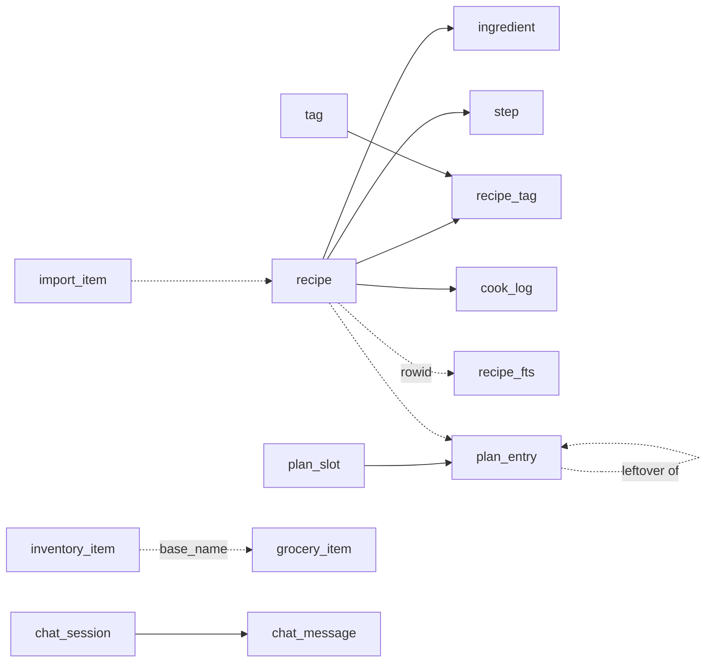
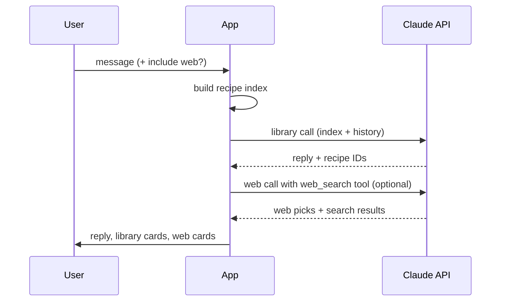

# Recipe Catcher — Tech Spec

How it's built: stack and modules, data model, fetchers, LLM calls, planner internals, backup format, build and release, errors and testing. Behaviour is defined in the App spec tab; build order is in the Waves tab. References to other tabs name the tab, e.g. "App spec section 2".

## 1. Stack and project structure

Native Kotlin and Jetpack Compose in three Gradle modules: a plain Kotlin `:core` module with all platform-independent logic, the Wear OS companion :wear, and the Android `:app` module. Package ID org.eu.angsumanray.recipecatcher; minSdk 31 (Android 12), targetSdk and compileSdk 37 (Android 17). Pin versions in `libs.versions.toml` and look up the latest stable of each at the start of the coding session rather than trusting this doc.

| Concern | Choice | Module | Why |
| --- | --- | --- | --- |
| UI | Jetpack Compose + Material 3, Navigation Compose (type-safe routes) | `:app` | Standard, fast to build |
| Wear UI | Wear Compose Material 3 (`androidx.wear.compose:compose-material3`) | `:wear` | Modern M3 watch components, rounded cards, responsive circular layouts |
| DI | Hilt | `:app` | Plays well with WorkManager and ViewModels |
| Database | Room + KSP, with an FTS4 table | `:app` | Offline, typed queries, full-text search |
| Background work | WorkManager (`CoroutineWorker`) | `:app` | Capture survives leaving the app, retries with backoff |
| Settings | DataStore (Preferences) | `:app` | Replaces SharedPreferences |
| Secrets | AES-GCM key in AndroidKeyStore, ciphertext in DataStore | `:app` | `EncryptedSharedPreferences` is deprecated ([source](https://developer.android.com/reference/kotlin/androidx/security/crypto/package-summary)) |
| HTTP | Ktor client (OkHttp engine on Android) | `:core` API, engine in `:app` | Ktor runs on JVM, Android and web, so `:core` stays portable |
| JSON | kotlinx.serialization | `:core` | Multiplatform |
| HTML parsing | Jsoup | `:core` | Mature; JVM-only, swap for Ksoup if a web target arrives |
| Images & Camera | Coil 3 (local files), Android Photo Picker (`PickVisualMedia` / `PickMultipleVisualMedia`), `FileProvider` for camera | `:app` | Compose-native loading; photo picker requires no runtime storage permissions |
| Zip | `java.util.zip` | `:app` | Built in |
| Tests | JUnit, Turbine, Ktor MockEngine, Room in-memory, Compose UI test | both | Covers parsers, DB, flows |

[Ksoup](https://github.com/fleeksoft/ksoup) is a Kotlin Multiplatform port of Jsoup with the same API, including a Wasm target, so the swap is mechanical.

**Package layout**

```
:core  (kotlin("jvm"), no android.* imports)
  model/      Recipe, Ingredient, Step, Tag, CookLogEntry, PlanSlot, PlanEntry, InventoryItem, GroceryItem, ChatMessage, SourceType (including image)
  domain/     QuantityScaler, FractionFormatter, IsoDuration
  capture/    UrlNormalizer, SourceClassifier
  insta/      oEmbed, embed and meta parsers (HTML string in, PostData out)
  web/        JsonLdRecipeParser, ReadableTextExtractor
  youtube/    PlayerResponseParser (watch page HTML in, VideoData out), YouTubeCaptionParser (timed-text XML/JSON cues into clean text)
  importer/   SavedPostsImporter (export file or text in, links + collections out)
  planner/    PortionLedger, GroceryBuilder, ReminderPlanner, PlanSuggester, TodaySnapshot
  llm/        RecipeExtractor, ClaudeClient, prompts, schemas, ChatPlanner
  backup/     Manifest model, format constants, validation rules
  ports/      HttpFetcher, Clock, RecipeCatalogue (interfaces the app implements)

:app   (Android phone, depends on :core)
  app/        App, MainActivity, ShareReceiverActivity, navigation
  data/db/    entities, DAOs, RecipeDatabase, FTS, RoomRecipeCatalogue
  data/repo/  RecipeRepository, TagRepository, CookLogRepository, PlanRepository, ListsRepository, ChatRepository
  data/settings/  SettingsStore, SecretStore
  capture/    CaptureWorker, ImportWorker, CommentFetcher (WebView), ImagePreprocessor (EXIF rotation, max 1568px downscaling, JPEG compression < 5MB, base64 encoding), image download
  updates/    UpdateChecker (GitHub Releases API client), ApkInstaller (FileProvider ACTION_VIEW)
  storage/    ImageCleanupWorker (WorkManager periodic/manual unreferenced image purging)
  reminders/  ReminderScheduler (AlarmManager), ReminderReceiver, BootReceiver
  widget/     TodayWidget (Jetpack Glance)
  wear/       WearSync (Data Layer publisher, /done listener, /update_available message to watch)
  backup/     BackupManager, RestoreManager (zip I/O, Storage Access Framework)
  ui/         today, plan, lists, library, review, viewer, cook, edit, chat, import, settings, components, theme

:wear  (Wear OS, same application ID and signing key as :app)
  data/       TodayRepository (Data Layer listener, offline tick queue)
  tile/       TodayTileService
  complication/  TodayComplicationService
  ui/         Today list (Wear Compose Material 3)
```

**Module rules**

- `:core` is a plain `kotlin("jvm")` module, so any `android.*` import fails the build. That is the enforcement.
- `:core` talks to the outside only through the interfaces in `ports/`; `:app` supplies Android implementations.
- All parsers take strings and return models; no networking inside parsers. This keeps them testable with fixtures.
- The backup zip format (section 7) is the data contract any future desktop or web app reads.
- A later desktop app (Compose Desktop) reuses `:core` as is. A web app would convert `:core` to Kotlin Multiplatform and swap Jsoup for Ksoup; Compose Multiplatform for web is in Beta ([source](https://blog.jetbrains.com/kotlin/2025/09/compose-multiplatform-1-9-0-compose-for-web-beta/)).

**Manifest essentials:** `INTERNET` and `POST_NOTIFICATIONS` permissions; `ShareReceiverActivity` with an `ACTION_SEND` / `text/plain` intent filter and a translucent theme; a FileProvider for camera photos (the system camera and photo picker need no CAMERA or storage permission); `android:allowBackup="false"` so the key never lands in Google's cloud backup.

## 2. Data model

Fourteen Room tables plus one FTS table, all created in schema version 1 in Wave 1, including those whose screens arrive in later waves, so building the waves needs no migrations. `exportSchema = true` keeps later changes testable: once the app holds real recipes, any schema change ships as a Room auto-migration, never a destructive one.

**Dates and times:** calendar dates (`plan_slot.date`, `cook_log.cooked_on`) are stored as ISO-8601 text (`YYYY-MM-DD`) and slot times as `HH:mm`, through Room TypeConverters for `LocalDate` and `LocalTime`, so grouping by day can't be shifted by time zones or daylight saving. Timestamps such as `created_at` stay epoch milliseconds.



**recipe**

| Column | Type | Notes |
| --- | --- | --- |
| id | Long PK auto | Also the FTS rowid |
| source\_type | Text | `instagram`, `web`, `youtube`, `manual`, or `image` |
| source\_key | Text, unique | Dedupe key: Instagram shortcode, YouTube video ID, normalized URL for web, random UUID for manual, or image SHA-256 / UUID for image captures |
| source\_url | Text? | Instagram: canonical `https://www.instagram.com/p/<code>/`; YouTube: `https://www.youtube.com/watch?v=<id>`; web: final URL after redirects; null for manual or image |
| author\_handle | Text? | Instagram handle without `@`, YouTube channel name, or the site name for web |
| caption\_raw | Text? | Source text sent to the LLM (caption, description, JSON-LD, page text or pasted text); never overwritten by edits |
| comment\_raw | Text? | Instagram top comment, if fetched |
| title | Text | Nullable column, since rows exist while pending; must be set before status becomes saved |
| description | Text? | One-line summary |
| servings | Int? | Base for scaling |
| prep\_min / cook\_min / total\_min | Int? | Minutes |
| cuisine | Text? | Free text, e.g. "Indian" |
| complexity | Text? | `easy`, `medium` or `hard` |
| complexity\_reason | Text? | One line from the AI, or the owner's override |
| spice\_level | Text? | `mild`, `medium` or `hot` |
| diet\_type | Text? | `vegan`, `vegetarian`, `eggetarian` or `non-veg` |
| kcal\_per\_serving | Int? | AI estimate, rounded to the nearest 10; null when quantities are too vague |
| make\_ahead / freezer\_friendly | Boolean | Default false |
| is\_favourite | Boolean | Default false; owner-only |
| personal\_note | Text? | Owner-only; never touched by extraction |
| reviewed | Boolean | False for bulk-imported recipes until saved from Edit; true for everything else |
| image\_path | Text? | Source image, relative path under `filesDir/images/` |
| cover\_photo\_path | Text? | Owner's chosen cook photo; shown instead of `image_path` when set |
| status | Text | `pending_fetch`, `pending_extract`, `needs_review`, `saved`, `failed_fetch`, `failed_extract`, `no_recipe_found` |
| error\_message | Text? | Last failure, shown on the Pending card |
| llm\_model | Text? | Model ID that produced the extraction |
| created\_at / updated\_at / saved\_at | Long | Epoch millis; saved\_at null until saved |

**ingredient** — `id`, `recipe_id` (FK, cascade delete), `position`, `group_name?`, `quantity?` (Double), `quantity_max?` (for ranges like 2–3), `unit?`, `name`, `base_name` (singular, no descriptors, e.g. "onion"; used to match the inventory and merge the grocery list), `category` (vegetables, fruit, dairy, meat & fish, grains & flours, spices, pantry, other), `note?` ("finely chopped"), `raw_text` (the original line, shown if parsing looks wrong).

**step** — `id`, `recipe_id` (FK, cascade), `position`, `text`, `timer_seconds?`.

**tag** — `id`, `kind` (`tag`, `diet`, `equipment` or `consumable`), `name` (unique per kind, `COLLATE NOCASE`), `position`. One table keeps all four vocabularies editable in the same list manager, and `recipe_tag` links recipes to any kind. A `diet` link means "this recipe contains it".

**recipe\_tag** — `recipe_id`, `tag_id` (composite PK, both FK cascade), `source` (`ai` or `user`).

**recipe\_fts** (FTS4, `tokenize=unicode61`) — columns `title`, `ingredients`, `steps`, `caption`, `author`, `notes`; `rowid` = recipe id. The repository rewrites the row in the same transaction as every recipe save, note edit or delete. Search query: sanitize user input, append `*` to each term, `MATCH` then join to `recipe` where `status = 'saved'`.

**chat\_session** — `id`, `title` (first user message, trimmed to 60 characters), `created_at`, `updated_at`.

**chat\_message** — `id`, `session_id` (FK, cascade), `role` (`user` or `assistant`), `text`, `include_web` (Boolean), `suggestions_json?` (library and web cards as returned, so history renders without another LLM call), `created_at`.

**cook\_log** — `id`, `recipe_id` (FK, cascade), `cooked_on` (date), `note?`, `photo_path?` (under `filesDir/images/cooked/`, resized to 1,600 px on the long edge, JPEG). "Last cooked" and "times cooked" are queried from here, not stored on `recipe`. Backups include the `cooked/` folder with the other images.

**Image files** — deleting a recipe deletes its source image and cook photos, and deleting a cook entry deletes its photo. A weekly WorkManager job (`ImageCleanupWorker`), and every restore, also removes any file under `filesDir/images/` that no row points to, which is what failed or cancelled captures leave behind. Cleanup can also be run on demand from Settings.

**import\_item** — `id`, `url`, `source_key` (unique), `collection?`, `status` (`queued`, `done`, `skipped`, `failed`), `recipe_id?`, `attempts`, `last_error?`, `created_at`. The import queue takes items in `created_at` order.

**llm\_usage** — `id`, `created_at`, `purpose` (`extraction`, `chat`, `planning` or `web`), `model`, `input_tokens`, `output_tokens`, `cache_read_tokens`, `web_searches`. Costs are computed from the Settings price table when shown, so a price change applies to the whole history.

**plan\_slot** — `id`, `date`, `name`, `time?`, `position`. Slots belong to a date, so every week can have its own layout.

**plan\_entry** — `id`, `slot_id` (FK, cascade), `kind` (`cook`, `prep` or `leftover`), `recipe_id?` (FK with ON DELETE SET NULL), `text?` (free-text prep), `portions` (cook: portions made; leftover: portions eaten), `portions_eaten_now` (cook only, default 1), `from_entry_id?` (a leftover's cook entry; FK with ON DELETE SET NULL, never cascade, so the app can ask what to do with leftovers before a cook entry or its slot is deleted), `prep_night_before` (Boolean), `done_at?`, `position`. Portions left on a cook entry = `portions` − `portions_eaten_now` − the portions of its leftover entries.

**Deleting a recipe that's in a plan:** the app first says how many plan entries use it and offers to remove them or keep them. Kept entries show as "Deleted recipe" with their slot and portions intact, and add nothing to the grocery list.

**inventory\_item** — `id`, `name`, `base_name` (unique), `category`, `status` (`in_stock`, `low` or `out`), `updated_at`.

**grocery\_item** — `id`, `name`, `base_name?`, `category`, `quantity_text?`, `source` (`plan`, `inventory` or `manual`), `week_start?`, `checked`, `position`.

**Settings keys (DataStore)**

Preferences are stored in Jetpack DataStore (and AndroidKeyStore for secrets):

| Setting Key | Type | Default | Purpose / Notes |
| --- | --- | --- | --- |
| `api_key` | Encrypted String | `""` | Anthropic API key; AES-GCM encrypted via AndroidKeyStore, ciphertext in DataStore |
| `model_id` | String | `claude-haiku-5-5` | Model ID for recipe extraction (captions, websites, transcripts, vision) |
| `chat_model_id` | String | `claude-haiku-5-5` | Model ID for Recipe Chat and Plan Suggester (allows selecting `claude-3-5-sonnet`) |
| `include_web_by_default` | Boolean | `false` | Default state for "Include web" search chip in chat |
| `max_web_searches` | Int | `3` | Max web searches per chat/find message |
| `allow_new_tags` | Boolean | `false` | Allow Claude to suggest non-canonical tags |
| `fetch_top_comment` | Boolean | `false` | Fetch top Instagram comment via authenticated WebView |
| `start_cooking_alerts` | Boolean | `true` | Notification for scheduled Cook entries |
| `prep_night_before_alert` | Boolean | `true` | Notification for night-before prep entries |
| `prep_night_before_time` | String | `21:00` | Alert time (`HH:mm`) for night-before prep |
| `last_backup_at` | Long | `0` | Epoch millis of last successful backup |
| `backup_folder_uri` | String? | `null` | Persisted tree Uri for one-tap backups |
| `recipes_since_last_backup` | Int | `0` | Counter triggering backup reminder snackbar |
| `last_update_check_at` | Long | `0` | Epoch millis of last GitHub Releases API check |
| `cached_latest_release_tag` | String? | `null` | Cached latest release tag name from GitHub (e.g. `v1.2.0`) |

**Starter lists** (edit before the first build; all four stay editable in Settings):

- **Tags:** breakfast, lunch, dinner, snack, dessert, drink, chicken, mutton, fish, seafood, paneer, indian, bengali, south-indian, chinese, italian, continental, quick (under 30 min), one-pot, baking, healthy, party. (Vegetarian and the like are covered by diet type, so they aren't tags.)
- **Diet ("contains"):** dairy, gluten, egg, nuts, peanuts, soy, sesame, shellfish, onion & garlic.
- **Equipment:** kadai, tawa, frying pan, saucepan, pot, pressure cooker, air fryer, OTG / oven, microwave, mixer-grinder, blender, hand mixer, stand mixer, food processor, steamer, grill pan, baking tray, cake tin, idli stand.
- **Consumables:** parchment paper, butter paper, aluminium foil, cling film, cellophane, wrapping paper, tissue / paper towels, muslin cloth, skewers, toothpicks, piping bag, ziplock bags.

## 3. Fetching (Instagram, websites, YouTube)

Caption fetching tries three strategies in order and stops at the first that returns a non-empty caption; every strategy sits behind one `PostFetchStrategy` interface so a broken one can be swapped without touching the rest.

```kotlin
interface PostFetchStrategy {
    val name: String
    suspend fun fetch(shortcode: String): PostData? // null = try next
}
data class PostData(val caption: String?, val author: String?, val imageUrl: String?)
```

| Order | Strategy | Request | What it gives | Notes |
| --- | --- | --- | --- | --- |
| 1 | Official oEmbed | `GET graph.facebook.com/<version>/instagram_oembed?url=<post>&omitscript=true` | Embed HTML containing the caption | Reported tokenless for public posts since June 2026 ([source](https://www.oembedproviders.com/oembed-providers/instagram/)); verify in the session. Thumbnail and author fields were removed in 2025 ([source](https://iframely.com/updates/193071-facebook-and-instagram-oembed-thumbnail-deprecation)) |
| 2 | Embed page | `GET instagram.com/p/<code>/embed/captioned/` | Caption, author, image | Unofficial HTML; parse with Jsoup |
| 3 | Post page meta | `GET instagram.com/p/<code>/` | `og:description`, `og:image`, `og:title` | Caption may be truncated; strip the "N likes, N comments – handle on date:" prefix |

**Rules**

- HTTP timeouts: 10 s connect, 15 s read; a mobile browser User-Agent for strategies 2–3.
- The image URL is merged from whichever strategy supplies one; download it straight away to `filesDir/images/<recipeId>.jpg` (Instagram CDN links expire).
- Unescape HTML entities, keep line breaks, drop hashtag-only trailing lines before sending to the LLM (keep them in `caption_raw`).
- Record which strategy succeeded in the log, for debugging breakages.
- Unit-test each parser against saved HTML fixtures in `test/resources/insta/`, so markup changes show up as failing tests.

**Top comment (P1, opt-in)**

- Settings → Instagram login opens a full-screen WebView on `instagram.com/accounts/login/`; cookies persist in the WebView `CookieManager`.
- `CommentFetcher` loads the post URL in an off-screen WebView, waits for page load plus up to 5 s, then runs `evaluateJavascript` to read the first comment's text.
- Keep the DOM selectors in one `InstaSelectors` object with a comment on how to refresh them; the fetcher returns null on any failure, never crashes the capture.
- One comment fetch per capture, never in bulk. It runs on the main thread from the foreground capture screen, never inside a background worker, so bulk imports skip it. A secondary Instagram account is recommended.

**Instagram carousel images (`CarouselExtractor`)**

- When an Instagram post's caption contains no recipe text (or yields `is_recipe: false` / "recipe in slides"), the fetcher extracts slide image URLs for slides 2–5 from post metadata (embed JSON or `edge_sidecar_to_children`).
- Slide 1 serves as the cover photo; slides 2–5 (which typically contain ingredient cards and method steps) are downloaded to cache and routed through `ImagePreprocessor` for multimodal vision extraction.

**Recipe websites (`WebRecipeFetcher`)**

Most recipe sites embed a schema.org `Recipe` object as JSON-LD; the fetcher sends that compact object to the LLM instead of the whole page, so web and Instagram recipes come out in the same shape.

1. `GET` the URL through HttpFetcher, following redirects, with a desktop Chrome User-Agent and `Accept-Language: en`. Cap the body at 5 MB.
2. Parse every `<script type="application/ld+json">` with Jsoup and kotlinx.serialization `JsonElement`. Walk top-level arrays and `@graph`, and take the first node whose `@type` is or contains `Recipe`.
3. Normalize the known quirks: `recipeInstructions` may be a string, a list of strings, `HowToStep` objects or `HowToSection` groups; `image` may be a string, an `ImageObject` or an array; `recipeYield` may be a number, a string or an array; times are ISO 8601 durations (`PT1H15M` = 75 min).
4. Send the normalized Recipe JSON to the extractor as the source text. The LLM splits ingredient lines into quantity, unit and name, and picks tags.
5. No JSON-LD Recipe: extract readable text. Drop `script`, `style`, `nav`, `header`, `footer`, `aside` and form elements, keep the element with the most paragraph text, cap at 12,000 characters.
6. LLM fails but JSON-LD exists: save a direct mapping (ingredient lines as `raw_text` only, no tags) as `needs_review`, so the recipe is never lost.
7. Image from JSON-LD `image`, else `og:image`; download to `filesDir/images/` as for Instagram. Site name from `og:site_name`, else the host.
8. HTTP 403/503 or a Cloudflare challenge page gives `failed_fetch` with "Paste page text". P1: retry from the foreground (a Retry tap on the capture screen, on the main thread, not in the worker) by loading the page in an off-screen WebView and reading `document.documentElement.outerHTML`.
9. Save HTML from at least 5 real recipe sites as fixtures in `test/resources/web/`.

**YouTube (`YouTubeFetcher` and `YouTubeCaptionParser`)**

1. Normalize to the video ID from `watch?v=`, `youtu.be/`, `shorts/` or `m.youtube.com` links.
2. `GET https://www.youtube.com/watch?v=<id>` with a desktop User-Agent, and parse the `ytInitialPlayerResponse` JSON embedded in the page ([technique](https://dev.to/wimdenherder/get-the-view-count-of-youtube-video-without-api-key-3gp0)): `videoDetails.title`, `videoDetails.author`, `videoDetails.shortDescription`.
3. Fallback: `og:title` and `og:description` meta tags (the description may be truncated).
4. Thumbnail from `https://i.ytimg.com/vi/<id>/hqdefault.jpg`, downloaded like other images.
5. Linked-page fallback: if extraction returns `is_recipe: false` and the description has links, try up to 2 non-social links through the website importer, keeping the YouTube URL as `source_url`.
6. Caption transcript extractor (`YouTubeCaptionParser` in `:core/youtube`):
   - When the description lacks recipe text, inspect `captions.playerCaptionsTracklistRenderer.captionTracks` from the player response.
   - Prioritize English subtitle tracks (`en`, `en-US`, `en-GB`), preferring manual tracks over auto-generated (`kind: "asr"`).
   - Fetch timed-text XML/JSON from the selected track's `baseUrl` (`https://www.youtube.com/api/timedtext?...`).
   - `YouTubeCaptionParser` parses the XML cues (`<text start="..." dur="...">...<text>`) or JSON cues:
     - Strips start/duration timestamps.
     - Strips XML/HTML formatting tags and unescapes entities (`&amp;` → `&`, `&#39;` → `'`).
     - Removes sound effects and musical tags (e.g. `[Music]`, `[Applause]`, `[Laughter]`, `♪ ... ♪`).
     - Collapses rolling/overlapping ASR line fragments into a clean, coherent continuous transcript string.
   - The cleaned transcript is passed to `RecipeExtractor` as `sourceText`.
   - *Note on voice transcription:* Audio/voice speech-to-text models (such as Whisper or on-device speech models) are intentionally omitted to avoid heavy native dependencies and battery drain; extraction relies entirely on YouTube's existing timed-text subtitle tracks.
7. Fixtures: The embedded JSON and timed-text formats are unofficial and can change. Keep fixtures in `test/resources/youtube/`; if it breaks often, add an optional YouTube Data API key in Settings as a sturdier source.

**Image preprocessor (`ImagePreprocessor` in `:app/capture`)**

Prepares images captured via Android Photo Picker (`PickVisualMedia` / `PickMultipleVisualMedia`), camera captures (`FileProvider`), or downloaded Instagram carousel slides for Claude multimodal vision extraction:

1. **Stream & EXIF inspection:** Reads the image stream or content `Uri` using Android's `ExifInterface`. Identifies orientation tags (`ORIENTATION_ROTATE_90`, `180`, `270`, flip/transposition) and applies rotation matrix transformations to yield an upright `Bitmap`.
2. **Dimension downscaling:** Downscales the bitmap so that its longest edge does not exceed 1,568 px (Anthropic's recommended ceiling for Claude vision to preserve fine text/typography while avoiding unnecessary token scaling and downsampling penalties).
3. **JPEG compression:** Compresses the rotated and resized bitmap into JPEG format at 80–85% quality. Validates that the output byte size is strictly below 5 MB (Anthropic API payload limit).
4. **Base64 encoding:** Encodes the compressed JPEG bytes to a Base64 string for direct inclusion in the Messages API `image` content block.

**Instagram saves import (`SavedPostsImporter`)**

- Accepts the export zip, `saved_posts.json`, or any text. It finds links with the same Instagram URL pattern as capture step 1, wherever they sit in the JSON, so small changes to the export format don't break it.
- Collection names: read them when the export has them and map them per link. The export format isn't officially documented, so check the real file in the session.
- Writes `import_item` rows. `ImportWorker` (WorkManager unique work, network constraint) takes one item about every 30 seconds through the normal capture pipeline and saves results with `reviewed = false`.

## 4. LLM calls, prompts and costs

One Messages API call per capture to `claude-haiku-5-5` with a JSON schema; roughly US$0.0006 per text recipe, so about US$0.06 per 100 recipes. Vision and chat use the configurations below.

**Interface**

```kotlin
interface RecipeExtractor {
    suspend fun extract(input: ExtractionInput): Result<ExtractedRecipe>
}
enum class SourceType { INSTAGRAM, WEB, YOUTUBE, MANUAL, IMAGE }
data class ExtractionInput(
    val sourceType: SourceType,
    val sourceText: String,                       // caption, video description, JSON-LD Recipe, page text, transcript, or pasted text
    val sourceImages: List<String> = emptyList(), // Base64 JPEG strings for vision extraction
    val topComment: String?,                      // Instagram only
    val author: String?,                          // handle, channel or site name
    val allowedTags: List<String>,
    val allowedDiet: List<String>,
    val allowedEquipment: List<String>,
    val allowedConsumables: List<String>,
    val allowNewTags: Boolean,
)
```

`ClaudeExtractor` is the only implementation in v1; callers only see `RecipeExtractor`, so another provider can be added later without touching them. Extraction tasks strictly use `claude-haiku-5-5`; chat and plan suggestion can select Sonnet 3.5 via Settings. API keys come from `SettingsStore` at call time.

**Request & Multimodal Vision payload format**

- `POST https://api.anthropic.com/v1/messages` with headers `x-api-key`, `anthropic-version: 2023-06-01` and `content-type: application/json`.
- `output_config.format` = `{"type": "json_schema", "schema": <schema below>}`, which guarantees schema-valid JSON ([structured outputs](https://platform.claude.com/docs/en/build-with-claude/structured-outputs)). Haiku 5.5 is on its supported-model list.
- Effort `low` for extraction (Haiku 5.5 thinks adaptively and defaults to `medium`); `max_tokens` 2,000.
- No `temperature`, `top_p` or `top_k`: Haiku 5.5 returns a 400 error for non-default values ([source](https://platform.claude.com/docs/en/models/haiku-5-5/overview)).
- The system prompt holds the rules; the user turn holds the source type, source text, comment, author and the tag list. Mark the system prompt with `cache_control` once it passes the 512-token caching minimum, so repeated captures pay the cache-read rate.

When `sourceImages` contains one or more Base64-encoded JPEGs (from the camera, Photo Picker, or Instagram carousel slides 2–5), the user message uses Anthropic's multimodal content block format:

```json
{
  "role": "user",
  "content": [
    {
      "type": "image",
      "source": {
        "type": "base64",
        "media_type": "image/jpeg",
        "data": "/9j/4AAQSkZJRg..."
      }
    },
    {
      "type": "text",
      "text": "Extract recipe from these images.\nSource type: IMAGE\nAuthor: ...\nAllowed tags: [...]"
    }
  ]
}
```

Multiple image blocks (e.g. carousel slides 2–5 or multi-page cookbook photos) are passed in sequential order as separate `{ "type": "image", ... }` objects before the final text prompt block.

**Dual model configuration & cost trade-offs**

- **Extraction tasks (always `claude-haiku-5-5`):** All extraction pipelines (Instagram captions & carousels, recipe websites, YouTube descriptions & caption transcripts, and camera/photo vision) strictly use `claude-haiku-5-5` for minimal latency (<5–8 s) and low cost.
  - Text captures: ~2,000 input tokens + 800 output tokens ≈ US$0.0006 per recipe.
  - Multimodal vision captures: Claude vision token calculation scales with resolution; an image downscaled to max 1,568 px long edge consumes ~1,600 input tokens. At Haiku 5.5 pricing (US$0.80 / MTok input), each image costs ~US$0.0013. A 4-slide carousel costs ~US$0.0052.
- **Recipe Chat and Plan Suggester (dual model selection in Settings):**
  - Uses `chat_model_id` from Settings: defaults to `claude-haiku-5-5`, with an option to select `claude-3-5-sonnet` (`claude-3-5-sonnet-latest`).
  - **Trade-offs:**
    - `claude-haiku-5-5`: US$0.80 / MTok input, US$4.00 / MTok output. Fast (~1.5 s), low cost. A library chat message with a 300-recipe index (~20,000 tokens) costs ~US$0.002.
    - `claude-3-5-sonnet`: US$3.00 / MTok input, US$15.00 / MTok output. Higher latency (~3–5 s), but provides superior culinary reasoning: nuanced flavor balance, sophisticated ingredient substitutions, multi-day pantry leftover sequencing, and deep understanding of complex dietary restrictions. A 20k-token library chat message costs ~US$0.06 on Sonnet 3.5.
  - Isolating the model choice to Chat and Plan Suggester ensures daily recipe captures never incur Sonnet pricing, giving the user control over when to spend on premium intelligence.

**Response schema** (every field required and none nullable; see Schema limits below)

```json
{
  "is_recipe": true,
  "title": "Paneer Butter Masala",
  "description": "Creamy tomato gravy with paneer",
  "servings": 4,
  "prep_minutes": 10,
  "cook_minutes": 25,
  "total_minutes": 35,
  "cuisine": "Indian",
  "complexity": "medium",
  "complexity_reason": "Two parts: the gravy and the paneer",
  "spice_level": "medium",
  "diet_type": "vegetarian",
  "contains": ["dairy", "nuts", "onion & garlic"],
  "kcal_per_serving": 450,
  "make_ahead": true,
  "freezer_friendly": false,
  "ingredient_groups": [
    {"name": "For the gravy", "items": [
      {"quantity": 2, "quantity_max": 0, "unit": "tbsp", "name": "butter", "base_name": "butter", "category": "dairy", "note": "", "raw": "2 tbsp butter"}
    ]}
  ],
  "steps": [{"text": "Simmer the gravy.", "timer_seconds": 600}],
  "equipment": ["kadai", "mixer-grinder"],
  "consumables": [],
  "tags": ["indian", "paneer"],
  "new_list_suggestions": [{"kind": "tag", "name": "restaurant-style"}],
  "confidence": 0.9
}
```

**Schema limits:** structured outputs allow at most 16 nullable (union-type) parameters and 24 optional ones per request ([limits](https://platform.claude.com/docs/en/build-with-claude/structured-outputs)), and a schema with nullable fields would pass 16. So every field is required and none is nullable: unknown text is `""`, unknown numbers are `0`, and enums carry an `unknown` value. The app maps these back to null in the database. Compare enum values case-insensitively, because structured outputs don't guarantee their capitalisation.

**System instruction rules**

1. Extract only what is in the text or images; never invent ingredients, quantities or steps.
2. If the input contains no recipe (e.g. "recipe in bio"), return `is_recipe: false` and empty values.
3. Quantities as decimals (½ → 0.5); ranges use `quantity_max`; "to taste" gives a 0 quantity with the phrase in `note`.
4. Use metric units: g, kg, ml, l, plus tsp, tbsp, pinch and pc. Convert imperial and US units: oz → g, lb → g or kg, fl oz → ml, cups → ml (1 US cup = 240 ml), a stick of butter → 113 g, inches → cm, and °F → °C inside steps. Round converted values sensibly (e.g. 454 g → 450 g). Keep unknown units as written; the original line always stays in raw.
5. Write output in English, translating when the source is in another language (e.g. Hindi, Bengali or Hinglish). Keep Indian ingredient names that are common in English (paneer, ghee, jeera) as they are. The original text is kept separately.
6. Split steps into single actions; set `timer_seconds` only when a duration is stated.
7. Pick `tags` only from the allowed list; put other ideas in `new_list_suggestions` (shown only when "Allow new AI tags" is on).

8) List the `equipment` and `consumables` the recipe needs, using names from the allowed lists; leave out basics every kitchen has (knife, spoon, chopping board, stove). Anything needed that fits no list goes into `new_list_suggestions` with its kind.
9) Rate `complexity`: `easy` (about 8 ingredients or fewer, under 30 minutes hands-on, basic techniques), `hard` (several components, special techniques or long processes), otherwise `medium`; give a one-line reason.

10. Rate `spice_level` as `mild`, `medium` or `hot` from the chillies and spices used. Set `make_ahead` or `freezer_friendly` only when the text says so or the dish clearly keeps (e.g. a gravy base); otherwise false.

11) Set `diet_type` from the ingredients (eggs make it `eggetarian`; any meat, fish or seafood makes it `non-veg`). List in `contains` every diet-list item present, including hidden sources (butter and cream are dairy; atta and maida are gluten).
12) Estimate `kcal_per_serving` from the listed ingredients and quantities divided by servings, rounded to the nearest 10; 0 when quantities or servings are missing.

13. For each ingredient give a `base_name` (singular, no descriptors: "red onions, finely chopped" → "onion") and a `category` from: vegetables, fruit, dairy, meat & fish, grains & flours, spices, pantry, other.

**Validation after the call**

- Decode with kotlinx.serialization (`ignoreUnknownKeys = true`); decode failure → one retry, then `failed_extract`.
- `is_recipe = false`, or zero ingredients and zero steps → `no_recipe_found`.
- Drop tags, diet items, equipment and consumables that aren't in their lists; clamp servings to 1–50 and minutes to 0–1,440.
- HTTP 401/403 → "Check API key"; 404 → "Model not found, update model ID"; 429, 529 (overloaded) or 5xx → WorkManager retry with exponential backoff, max 3 attempts.

**Cost estimate:** about 2,000 input tokens (Haiku 5.5's tokenizer counts roughly 30% more than older Claude models) and 800 output tokens per text capture, at US$0.80 / US$4.00 per million tokens ([source](https://platform.claude.com/docs/en/models/haiku-5-5/overview)) ≈ US$0.0006 per recipe. Pages without JSON-LD send up to about 5,000 input tokens, still under US$0.001. Images add ~1,600 input tokens (~US$0.0013) each.

**Usage tracking:** every Claude response's `usage` block (input, output and cache-read tokens, plus `server_tool_use.web_search_requests` for web calls) is written to `llm_usage`. The AI spend panel in Settings multiplies these by the price table.

## 5. Recipe chat

Each user message triggers a library call and, when "Include web" is on, a separate web call with Claude's web search tool. Keeping them separate lets library picks appear straight away and limits search charges to messages where you asked for the web.



The library call and the web call run in parallel, and the reply renders as soon as the library call returns.

**Library call (`ChatPlanner` in `:core`)**

1. Build the index from saved recipes, one line each: `id | title | tags | up to 8 main ingredients | total min | complexity | spice | diet type | contains | kcal | make-ahead / freezer | equipment | favourite | last cooked`. About 70 tokens per recipe.
2. Up to 300 recipes: send them all. Above that, pre-filter with FTS on words from the message plus tag matches, and send the top 150.
3. Send the last 10 messages of the chat as history.
4. System instruction: suggest at most 5 recipes, only by IDs from the index; weigh ingredients on hand, mood, time, spice preference, diet and "without" requests ("veg, no dairy"), lighter or heavier meals by calories, equipment the user has or lacks ("no oven today"), whether they want something to make ahead, favourites, and how long since each was cooked; list missing ingredients; ask one follow-up question if the request is too vague.
5. Response schema:

```json
{
  "reply": "Two easy ones that use your paneer...",
  "suggestions": [
    {"recipe_id": 42, "reason": "25 min, uses paneer and spinach", "missing": ["cream"]}
  ],
  "follow_up_question": ""
}
```

6. Validate: drop IDs not in the index, cap at 5.

**Web call (only when "Include web" is on)**

1. A separate Messages API call with `tools: [{"type": "web_search_20260209", "name": "web_search", "max_uses": 3}]` (the cap comes from Settings), the user's message, the ingredients and mood, and an instruction to return up to 3 pages with full recipes, not videos.
2. Ask for the picks as a fenced JSON block (`title`, `url`, `site`, `reason`) and parse it. Don't add `output_config.format` here: web search answers carry citations, and the structured-outputs docs list citations as incompatible ([source](https://platform.claude.com/docs/en/build-with-claude/structured-outputs)).
3. Web search runs on Anthropic's side inside the same request, so the app has no tool-result round trip to handle. If the response ends with `stop_reason: "pause_turn"`, send it back as the assistant turn to let it finish.
4. Keep only URLs that appear in the response's `web_search_tool_result` blocks, so a card never points at a page the search didn't return.
5. Save hands the URL to the website importer as usual.

**Cost:** a library call with 300 recipes is about 20,000 input tokens, roughly US$0.002 per message. Web search adds US$0.01 per search ([source](https://docs.apiyi.com/en/api-capabilities/claude-web-search)), so at most US$0.03 per web message with the default cap of 3.

**Find with AI (edit form)**

1. The same web call as above, with the dish name and hints as the request and an instruction to return up to 3 pages that contain a full recipe.
2. The form shows the candidates; picking one runs its URL through the website importer (section 3) and the extractor, then fills the form without saving.
3. If the chosen page can't be fetched, the form says so and offers the next candidate.
4. Cost is the same as a web chat message: at most US$0.03 in searches plus about US$0.001 in tokens.

## 6. Planner, lists, reminders and widget

All planner logic lives in `:core/planner` and runs locally; the only LLM call is `PlanSuggester`, and only when you tap Suggest.

- **PortionLedger:** computes portions left per cook entry and lists the leftovers available on any date; deleting a cook entry asks what to do with its leftover entries.
- **GroceryBuilder:** for a week, takes Cook and Prep entries that have a recipe, scales each ingredient by planned portions ÷ recipe servings, and groups by `base_name` and unit family (g/kg and ml/l convert; tsp, tbsp, pinch and pc only merge with the same unit). Lines without a quantity are listed once by name. It then removes in-stock inventory items, marks low ones, adds items marked out, and merges with existing manual items and ticks.
- **Inventory sync:** ticking a grocery item upserts the inventory item by `base_name` as `in_stock`; setting an inventory item to `out` upserts a grocery item with `source = inventory`.
- **ReminderPlanner + ReminderScheduler:** works out alert times from the plan and schedules them with `AlarmManager.setWindow` (about a 10-minute window), so the app needs no exact-alarm permission. Rescheduled on every plan change, on boot (`RECEIVE_BOOT_COMPLETED`) and on time or time-zone changes. Each notification has a "Done" action handled by `ReminderReceiver`.
- **TodayWidget:** a Jetpack Glance app widget fed by the same Today query as the home screen. Ticking runs a Glance action callback that marks the entry done; the widget refreshes on database changes and after a midnight alarm.
- **PlanSuggester:** one Messages API call with the recipe index (same format as chat), the week's current entries, in-stock and low inventory names, available leftovers and the empty slots to fill. Schema: `[{"slot_id": 12, "recipe_id": 42, "portions": 4, "reason": "uses your spinach before it goes"}]`, at most 3 per slot. Validated like chat (unknown IDs dropped). About US$0.002 per tap.

**Wear OS companion (`:wear` module)**

- **Wear Compose Material 3:** Built with `androidx.wear.compose:compose-material3` (migrated to modern Wear OS M3), featuring Material You design tokens, rounded card containers, responsive layouts optimized for circular viewports (`TransformingLazyColumn`), and high-contrast typography.
- Tiles service (`TodayTileService`) and complication data source (`TodayComplicationService`); minSdk 30, covering Wear OS 3 and later.
- **Pairing rule:** the watch app must use the same application ID and the same signing key as the phone app, or the two can't see each other over the Data Layer ([example](https://capgo.app/blog/capacitor-wear-os-app/)). Debug builds therefore use the `.debug` suffix on both.
- **Phone → watch synchronization:**
  - `WearSync` in `:app` publishes a Today snapshot (entry ID, title, kind, slot, time, done) as a `DataItem` at `/today` whenever the plan or a done state changes, and after midnight.
  - When `UpdateChecker` on the phone detects a new GitHub release, `WearSync` sends a `MessageClient` message to `/update_available` on the watch with the version tag payload (e.g. `{"version": "v1.2.0"}`). The watch companion posts a local system notification alerting the user that a new release is ready.
- **Watch → phone:** a tick sends a `MessageClient` message to `/done` with the entry ID; the phone marks it done and republishes. If the phone is unreachable, the watch stores the tick in a small DataStore queue, which survives watch reboots, and retries on reconnect.
- **Install and updates:** the release workflow builds and signs the watch APK with the same key and attaches it to the same GitHub Release. Install and update it over Wi-Fi debugging with `adb install -r`, or download directly following update notification alerts.

## 7. Backup zip format and restore

A backup is one zip holding a manifest, a single-file copy of the database and the image folder; restore validates everything in a temp directory before touching live data.

```
recipes-20260923-2130.zip
  manifest.json
  db/recipes.db
  images/<recipeId>.jpg ...
```

**manifest.json**

```json
{
  "format": "recipe-catcher-backup",
  "format_version": 1,
  "db_schema_version": 1,
  "app_version": "1.0.0",
  "created_at": "2026-09-23T21:30:00+05:30",
  "recipe_count": 128,
  "image_count": 121,
  "db_sha256": "…"
}
```

**Backup steps (`BackupManager`)**

1. Run `VACUUM INTO '<cacheDir>/backup/recipes.db'` on the open database: a consistent single-file copy with no WAL files, no need to close Room.
2. Hash it, count rows, write `manifest.json`.
3. Stream manifest, database and every file in `filesDir/images/` into a `ZipOutputStream` on the `Uri` from `ACTION_CREATE_DOCUMENT` (or a file created in the remembered tree `Uri`). Images use `STORED`, not `DEFLATED`, since JPEGs don't compress.
4. Delete the temp copy; save `last_backup_at` and reset the new-recipe counter.

**Restore steps (`RestoreManager`)**

1. Unzip to `cacheDir/restore/`. Reject entries whose path contains `..` or starts with `/` (zip-slip).
2. Check `format`, `format_version <= 1`, `db_schema_version <=` current, and the SHA-256.
3. Open the temp database read-only; run `PRAGMA integrity_check` and count recipes.
4. Show the confirm dialog; write the automatic safety backup.
5. Close Room, replace the database file (deleting stale `-wal` / `-shm`), replace `filesDir/images/`, then restart the process: schedule MainActivity a moment ahead with an AlarmManager PendingIntent (or use the ProcessPhoenix library), and exit once Room is closed and running queries are cancelled. A backup from an older schema version goes through Room migrations on reopen.
6. Any failure before step 5 leaves live data untouched; a failure during step 5 restores the safety backup.

## 8. Build, signing, updates and maintenance

Day-to-day development runs from Android Studio over wireless debugging; releases are built and signed by GitHub Actions and can be updated either in-app via `UpdateChecker` or installed by hand from GitHub Releases.

- **Repo:** a private GitHub repository (`angsuman/recipe-catcher`).
- **Signing key:** generate one release keystore at the start. Store it base64-encoded as an Actions secret with its passwords, and keep an offline copy in a password manager. Android only installs updates signed with the same key, so losing it means uninstalling and restoring from a backup.
- **Release workflow:** pushing a tag like `v1.2.3` runs the unit tests, `:app:assembleRelease` (R8 on) and `:wear:assembleRelease`, signs both APKs (`app-release.apk`, `wear-release.apk`), and attaches them to a GitHub Release. `versionName` comes from the tag and `versionCode` from the workflow run number.
- **CI on every push:** unit tests, plus the check that `:core` has no Android dependencies (`verifyCoreIsolation`).
- **Migration safety:** before running a database migration on startup, the app writes an automatic backup to app-private storage, so an update can't strand your data.
- **Debug builds** use a `.debug` package suffix, so they install alongside the release build without touching your real library.

**In-app update checker (`UpdateChecker` and `ApkInstaller` in `:app/updates`)**

- **GitHub Releases API client:**
  - Queries `GET https://api.github.com/repos/angsuman/recipe-catcher/releases/latest` with `Accept: application/vnd.github.v3+json` and `User-Agent: RecipeCatcher-Android`.
  - Parses JSON fields: `tag_name` (e.g. `v1.2.0`), `name`, `body` (markdown release notes), and the `assets` list.
  - Strips leading `v` and compares the release tag against `BuildConfig.VERSION_NAME` using semantic version parsing (`major.minor.patch`).
  - Matches assets by filename pattern: `app-release.apk` (phone) and `wear-release.apk` (watch).
  - Caches `last_update_check_at` and `cached_latest_release_tag` in DataStore.
- **Trigger points:**
  - On-demand: Tapping "Check for updates" in Settings runs the check immediately and displays the release notes dialog with a "Download & Install" action.
  - Background: A low-frequency WorkManager `PeriodicWorkRequest` (e.g. daily, requiring unmetered network) checks in the background. If a newer release is found, it posts a high-priority system notification on the phone.
- **Package installation (`ApkInstaller`):**
  - Downloads `app-release.apk` into app cache (`cacheDir/updates/update.apk`).
  - Generates a content URI via `FileProvider` (`content://org.eu.angsumanray.recipecatcher.fileprovider/updates/update.apk`).
  - Launches `Intent(Intent.ACTION_VIEW)` with flags `FLAG_GRANT_READ_URI_PERMISSION` and `FLAG_ACTIVITY_NEW_TASK`, and MIME type `application/vnd.android.package-archive`.
  - Prompts the standard Android package installer.
- **Wear companion update propagation:**
  - When a new release is confirmed with a `wear-release.apk` asset, `WearSync` sends a `/update_available` Data Layer message to the paired watch.
  - The watch companion shows a notification advising the user to update the watch companion via `adb install -r` or companion tooling.

**Storage maintenance (`ImageCleanupWorker` in `:app/storage`)**

Over time, failed extractions, discarded recipe imports, cancelled photo attachments, or deleted items can leave unreferenced images in local storage.

- **Mechanism:**
  - Implemented as a WorkManager `CoroutineWorker`.
  - Queries all active image file paths from the Room database:
    - `recipe.image_path` (source post/web/video images)
    - `recipe.cover_photo_path` (user-chosen covers)
    - `cook_log.photo_path` (cook log photos)
  - Scans disk files in `filesDir/images/` and `filesDir/images/cooked/`.
  - Normalizes relative paths and computes the difference: `unreferenced = diskFiles - dbReferencedFiles`.
  - Deletes all orphaned files from disk while strictly preserving active images.
  - Returns the count of deleted files and total bytes reclaimed.
- **Execution triggers:**
  - **Manual:** Settings → Maintenance → "Clean storage" executes the worker immediately in the foreground and shows a snackbar reporting results (e.g. "Freed 12.4 MB across 6 unreferenced images").
  - **Scheduled:** Configured as a weekly background WorkManager job with constraints (`requiresBatteryNotLow`).
  - **Safety check:** Automatically invoked during backup restore operations to purge lingering remnants before writing restored assets.

## 9. Errors and testing

Build order and the acceptance check for each stage are in the Waves tab.

**Error handling**

| Failure | Status | User sees | Action |
| --- | --- | --- | --- |
| No URL in shared text | — | Toast "No link found" | Close |
| No network | `pending_fetch` | Pending card "Waiting for network" | Auto-run when online |
| All fetch strategies fail | `failed_fetch` | "Couldn't read this post" | Retry, Paste caption |
| No API key | `pending_extract` | Prompt to add key | Opens Settings |
| LLM error or bad JSON | `failed_extract` | "Couldn't read the recipe" | Retry |
| No recipe in text | `no_recipe_found` | "No recipe in caption" | Enter by hand, Delete |
| YouTube video has no captions or track fetch fails | `no_recipe_found` | "No recipe in description or captions" | Enter by hand, Paste text |
| Image unreadable or exceeds Claude vision size | `failed_extract` | "Image processing failed or file too large" | Try another photo, Crop image |
| GitHub Releases check fails (offline / rate limit) | — | Snackbar "Update check failed (network/rate limit)" | Retry later |
| Backup or restore fails | — | Error dialog with reason | Live data untouched |

**Testing**

- Unit: `UrlNormalizer` (post, reel, reels, tv, tracking params, short links), the three Instagram parsers plus the JSON-LD parser, IsoDuration, readable-text extractor, YouTube player-response parser and saved-posts link extractor against HTML fixtures, `QuantityScaler`, `FractionFormatter`, LLM JSON decoding with good, partial and broken fixtures.
  - `YouTubeCaptionParser` against XML and JSON timed-text fixtures (`test/resources/youtube/timedtext_en.xml`, `timedtext_asr.json`), asserting timestamp stripping, markup removal, musical/sound effects filtering (`[Music]`, `[Applause]`), entity decoding, and text normalization.
  - `ImagePreprocessor` tests verifying EXIF orientation handling (rotation of 90°, 180°, 270° tags), aspect-ratio preserving downscale to max 1,568 px long edge, JPEG compression bounds (< 5 MB), and valid Base64 payload generation.
  - `UpdateChecker` tests against mock GitHub Release JSON fixtures (`test/resources/updates/release_latest.json`), asserting semantic version comparison (`1.0.0` vs `1.1.0`), asset filtering (`app-release.apk`, `wear-release.apk`), and error handling on HTTP 403/404.
  - `ImageCleanupWorker` unit test with mock disk images and DAO queries, asserting orphaned files are purged, active covers/photos are preserved, and freed byte counts match.
- Integration: Room DAOs and FTS in memory; `ClaudeExtractor` against Ktor MockEngine (200, 401, 404, 429); multimodal Vision API payload serialization tests verifying structure with multiple `image` source blocks alongside JSON schema enforcement; `CaptureWorker` state transitions; chat response validation (unknown recipe IDs dropped, cap of 5) with a mocked Claude API; a build check that `:core` has no Android dependencies (`verifyCoreIsolation`).
- Backup round trip: seed 50 recipes with images → backup → wipe → restore → deep compare.
- Manual: 10 real recipe posts (5 caption-only, 3 recipe-in-comment, 2 no recipe) plus 5 recipe websites (4 with JSON-LD, 1 without), 3 YouTube Shorts with descriptions or timed-text captions, and 3 image captures (cookbook photo, handwritten recipe, Instagram carousel slide) as the acceptance set.

**Sources**

- [Instagram oEmbed endpoint notes](https://www.oembedproviders.com/oembed-providers/instagram/)
- [Instagram oEmbed field deprecations](https://iframely.com/updates/193071-facebook-and-instagram-oembed-thumbnail-deprecation)
- [Instagram: download your information](https://help.instagram.com/ipad-app/181231772500920)
- [Example importer reading Instagram's saved\_posts.json](https://pypi.org/project/ig2raindrop-cli/)
- [Reading YouTube's ytInitialPlayerResponse without an API key](https://dev.to/wimdenherder/get-the-view-count-of-youtube-video-without-api-key-3gp0)
- [Claude Haiku 5.5 overview: pricing, limits, sampling-parameter rule](https://platform.claude.com/docs/en/models/haiku-5-5/overview)
- [Claude structured outputs](https://platform.claude.com/docs/en/build-with-claude/structured-outputs)
- [Claude tool use, including the web search tool](https://platform.claude.com/docs/en/agents-and-tools/tool-use/)
- [Web search pricing and tool versions](https://docs.apiyi.com/en/api-capabilities/claude-web-search)
- [androidx.security.crypto deprecation](https://developer.android.com/reference/kotlin/androidx/security/crypto/package-summary)
- [Ksoup, Kotlin Multiplatform port of Jsoup](https://github.com/fleeksoft/ksoup)
- [Compose Multiplatform for web goes Beta](https://blog.jetbrains.com/kotlin/2025/09/compose-multiplatform-1-9-0-compose-for-web-beta/)
