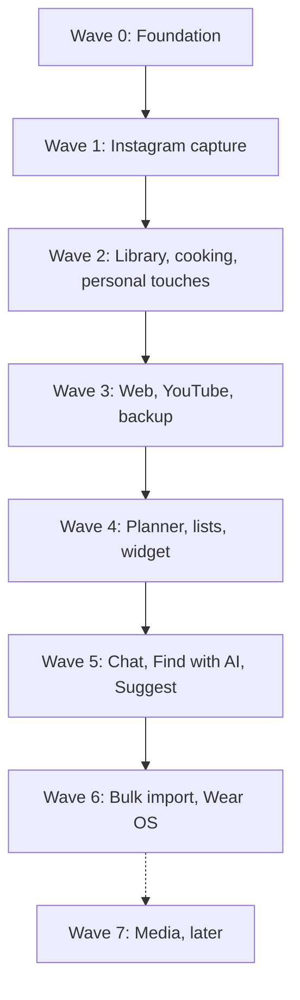

# Recipe Catcher — Wave Plan

Build order for v1. Every wave ends with a tagged, signed release that installs over the previous one, and its "Done when" check says when the wave is finished. Behaviour is defined in the App spec tab and implementation in the Tech spec tab.

**Rules for every wave**

- All tables are created in Wave 1's schema v1. Later schema changes ship as Room auto-migrations with exported schemas and a migration test; nothing destructive once the app holds real recipes.
- Until Wave 3 adds backup, the app is not your only copy: keep the Instagram saves and links you capture.
- CI green, release tagged, APK installed over the previous build.
- LLM calls only where the Tech spec puts them; every call is logged to `llm_usage` from Wave 1.

**Changes from the draft plan**

- compileSdk and targetSdk are 37 (the draft said 36/37).
- Paste link and the AI spend panel move to Wave 1: pasting is basic capture, and usage is logged from the first call.
- Prompt caching is a `cache_control` field on the system prompt, not a header.
- Re-extract and orphaned-image cleanup join Wave 2; the WebView retry for blocked sites joins Wave 3, run from the foreground only.
- Leftover links use `ON DELETE SET NULL`; restore restarts the app with an AlarmManager PendingIntent or ProcessPhoenix.
- The top-comment fetch stays in Wave 6 and runs only during a foreground capture.
- Wave 7 reads images with Haiku 5.5's image input rather than a separate OCR library.

## Wave 0 — Foundation

Repository, modules, CI, signing and release pipeline, plus the pure-Kotlin domain logic everything else builds on.

- [x] Gradle version catalog; `:core` as `kotlin("jvm")` with no Android dependencies; `:app` with compileSdk and targetSdk 37, minSdk 31. (`:wear` arrives in Wave 6.)
- [x] Hilt, Room with KSP and exported schemas, Compose Material 3 with dynamic colour and dark theme by default.
- [x] GitHub Actions: unit tests and the `:core` isolation check on every push; a version tag builds the signed APK and attaches it to a GitHub Release.
- [x] Release keystore generated once, stored as an Actions secret and in your password manager.
- [x] Domain models: Recipe, Ingredient, Step, Tag, CookLogEntry, PlanSlot, PlanEntry, InventoryItem, GroceryItem.
- [x] QuantityScaler (single values and ranges), FractionFormatter (fractions for tsp, tbsp and pieces; metric rounding; g → kg and ml → l), IsoDuration.
- [x] UrlNormalizer and SourceClassifier for Instagram, YouTube and web links, including tracking-parameter stripping.
- [x] Unit tests for all of the above.

**Done when:** a tagged build produces a signed APK that installs on the phone, and CI fails if `:core` imports anything from Android.

## Wave 1 — Instagram capture

Share a post, fetch it in the background, extract it with Claude, review and save.

- [x] `HttpFetcher` port with the Ktor client (OkHttp engine on Android).
- [x] Instagram strategies: oEmbed, `/embed/captioned/`, meta tags, each tested against saved HTML fixtures.
- [x] `ClaudeExtractor`: Messages API with an all-required, non-nullable JSON schema, effort low, no temperature, `cache_control` on the system prompt, and error mapping for 401, 404, 429, 529 and 5xx.
- [x] Room schema v1 with all fourteen tables plus `recipe_fts` (Tech spec section 2), including those whose screens arrive in later waves; dates stored as ISO text through a TypeConverter; starter lists seeded.
- [x] `SettingsStore` and `SecretStore` (AndroidKeyStore AES-GCM); Settings with API key and Test, model ID, theme, and the AI spend panel.
- [x] `CaptureWorker` state machine, dedupe and thumbnail download.
- [x] `ShareReceiverActivity` and the Paste link screen; the capture screen watches the row and opens Review when it reaches `needs_review`.
- [x] Review and tag screen; Save. The app opens on a simple list of saved and pending recipes, which Wave 2 grows into the full Library.
- [x] Tests: parser fixtures, Ktor MockEngine for the Claude API, worker state transitions.

**Done when:** sharing a real Instagram post ends in a saved recipe, and the AI spend panel shows what it cost.

## Wave 2 — Library, cooking and personal touches

Everything you need to find, read and cook offline, plus your own layer on top.

- [x] FTS search with prefix matching; filter engine for tags, diet type, "without" flags, favourites, never cooked, complexity, equipment, spice, make-ahead and freezer; sorts.
- [x] Library grid with the Pending section and retry.
- [x] Recipe viewer: Coil 3 images, servings stepper with range scaling, ingredient checklist, equipment and consumables, notes.
- [x] Cooking mode: keep-screen-on, step timers, ingredients sheet, Mark as cooked.
- [x] Cooked log with an optional photo (camera through a FileProvider, or the photo picker) and cover choice.
- [x] Favourites and personal notes.
- [x] Write recipe: empty form plus Fill from pasted text. (Find with AI comes in Wave 5.)
- [x] List manager in Settings for tags, diet, equipment and consumables.
- [x] Re-extract from stored source text.
- [x] Orphaned-image cleanup job.

**Done when:** 8 of the 10 Instagram acceptance posts are usable without edits, and a recipe can be cooked start to finish in cooking mode.

## Wave 3 — Web, YouTube, backup and restore

The other two link sources, and the safety net that makes the app safe to rely on.

- [x] `WebRecipeFetcher`: JSON-LD parsing, readable-text fallback capped at 12,000 characters, direct-mapping fallback, `og:image`.
- [x] `YouTubeFetcher`: player-response parsing, meta-tag fallback, linked-page fallback.
- [x] Clipboard detection on Paste link for all link types; Paste page text escape hatch.
- [x] WebView retry for blocked sites, from a foreground Retry tap only.
- [x] `BackupManager`: `VACUUM INTO`, manifest, SHA-256, zip through the Storage Access Framework, remembered folder.
- [x] `RestoreManager`: zip-slip check, manifest and integrity checks, safety backup, Room close, file swap, restart.
- [x] Automatic backup before any database migration; backup reminder.
- [x] Tests: 5 website and 3 Shorts fixtures; 50-recipe backup round trip.

**Done when:** 4 of the 5 acceptance websites and 2 of the 3 Shorts are usable without edits, and backup → wipe → restore gives an identical library.

## Wave 4 — Planner, lists, reminders and widget

Week planning, Today, the grocery list and inventory, and the home-screen widget, with no LLM calls.

- [x] Bottom tabs (Today, Plan, Library, Lists) with Today as the start screen, replacing the Library-first launch of Waves 1–3.
- [x] `PortionLedger`, `GroceryBuilder` and `ReminderPlanner` in `:core/planner`, with tests.
- [x] Planner tables already exist from schema v1; confirm `recipe_id` and `from_entry_id` on `plan_entry` both use `ON DELETE SET NULL`.
- [x] Week plan: custom slots per day, cook / prep / leftover entries, move, copy last week's layout, Add to plan from the viewer.
- [x] Today screen; ticking a cook entry writes the cooked log.
- [x] Lists: grocery list (build from plan, categories, ticks update the inventory) and inventory (in stock, low, out).
- [x] Reminders with `AlarmManager.setWindow`, rescheduled on boot and time changes, with a Done action; settings for week start and alerts.
- [x] `TodayWidget` with Jetpack Glance.

**Done when:** a real week with leftovers shows correctly on Today and the widget, alerts fire, and the grocery list skips in-stock items.

## Wave 5 — Chat, Find with AI and Suggest

The three features that call the LLM on demand, sharing one web-search client.

- [x] Web call: `web_search` tool with `max_uses`, fenced-JSON parsing, `pause_turn` handling, URLs kept only from search results.
- [x] `ChatPlanner` library call with the recipe index, FTS pre-filter above 300 recipes, and ID validation.
- [x] Chat screen: history, quick prompts, Include web toggle, library and web cards, Save through the importer.
- [x] Find with AI on the edit form.
- [x] `PlanSuggester` with Suggest and Fill empty slots in the planner.

**Done when:** "I have eggs, onions and 20 minutes" returns sensible library picks, a web pick saves through the importer, and Suggest fills a slot.

## Wave 6 — Bulk import, top comments and Wear OS

Your Instagram backlog, the comment fallback, and the watch.

- [ ] `SavedPostsImporter` and `ImportWorker`: one post about every 30 seconds, pause and resume, 30-minute cooldown after 3 failures, collection tags, To review filter, Skipped list.
- [ ] Instagram login WebView and top-comment fetch, run only during a foreground capture.
- [ ] `:wear` module: Today list, tile, complication, Data Layer sync, DataStore tick queue.
- [ ] Release workflow builds and signs the phone and watch APKs with the same key; the watch app installs with `adb install -r`.

**Done when:** a real export imports with no duplicates and survives a restart mid-queue, and a tick on the watch updates the phone and widget within seconds.

## Wave 7 — Media (later)

- [ ] Recipes from images (carousel slides, screenshots, cookbook photos) using Haiku 5.5's image input.
- [ ] Voice transcription of reels and videos, and YouTube transcript extraction.

To be detailed before the wave starts.
